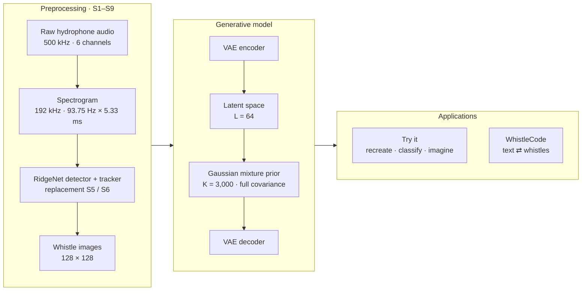
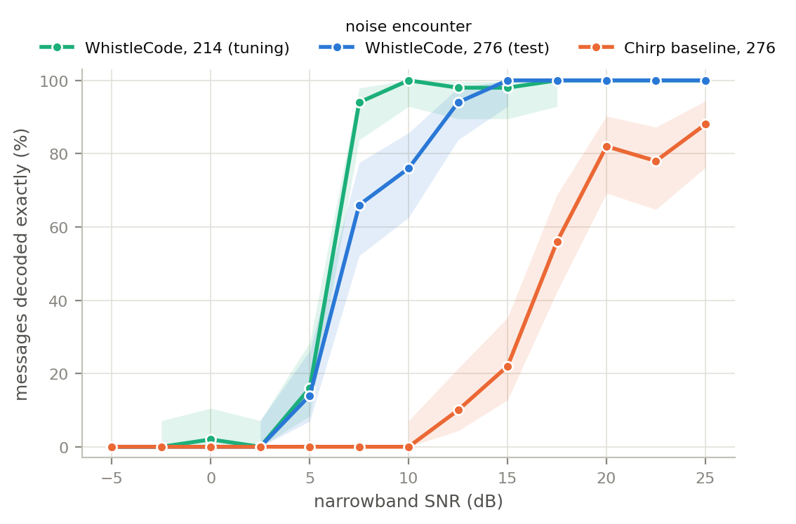

<div align="center">

# whistlepipe

**An end-to-end, auditable reproduction of VAE-GMM for cetacean whistles**

From raw hydrophone recordings to a generative model of false killer whale whistles, an interactive web instrument and a covert acoustic message channel.

[](https://www.python.org/)
[](https://pytorch.org/)
[](https://github.com/anonymus-k-dot/cetacean_whistle_reproduction/actions/workflows/ci.yml)
[](CHANGELOG.md)
[](LICENSE)
[](https://doi.org/10.1109/ACCESS.2026.3664765)
[](#dataset-record)


<sub>Whistles sampled from 25 components of the fitted Gaussian mixture and decoded by the trained VAE (the paper's Fig. 7 protocol).</sub>

</div>

---

This repository reimplements, stage by stage, the method of Park *et al.*, *"A Generative Model for Cetacean Whistles Using Variational Autoencoder and Mixture of Gaussians"*, *IEEE Access* 14 (2026), 27877–27894. Whistle contours are extracted from spectrograms and rendered as 128 × 128 images. A variational autoencoder (latent dimension L = 64, with an adversarial critic) learns a latent space, and a full-covariance Gaussian mixture models that space as an explicit prior that can be sampled.

The reproduction draws on the paper's own source collection: false killer whale (*Pseudorca crassidens*) recordings from the 2017 HICEAS survey, released by NOAA as part of DCLDE 2022. It uses a different selection of files, though. All eight encounters of ship 1705 are processed (1,415 files), and the model is trained on one of them. Every result can be traced from the SHA-256 of a raw file to the checkpoint that produced it.

### Highlights

- **Complete pipeline.** 1,415 raw recordings are turned into 180,154 whistle images with no failed files. Training, mixture fitting, evaluation, inference and sonification all run from one CLI.
- **Faithful where it can be measured.** SSIM is 0.990 against the paper's 0.986. The Fig. 12 diagonal structure appears for all 13 generation conditions. The decoder's size and cost are identical to the paper's: 368,097 parameters and 557.3 MFLOPs.
- **Clear about evidence.** Each parameter is tagged as paper evidence or an implementation decision. The paper-defined configuration is locked, and every deviation is recorded.
- **Beyond the paper.** The trained model drives a web instrument, and it is the alphabet of **WhistleCode**, which hides text messages in synthetic whistles. That is the biomimetic underwater-communication setting that motivates the paper.

## Contents

[Project status](#project-status) · [Method](#method) · [Results](#results) · [Dataset record](#dataset-record) · [WhistleCode](#whistlecode-messages-hidden-in-whistles) · [Getting started](#getting-started) · [Command reference](#command-reference) · [Repository layout](#repository-layout) · [Research integrity](#research-integrity) · [Limitations](#known-limitations) · [Documentation](#documentation) · [Citation](#citation)

## Project status

*As of 20 November 2026.*

| Component | State | Notes |
|---|---|---|
| Preprocessing (S1–S9) | **Complete** | 1,415 / 1,415 files processed, 0 failed; 180,154 images from 8 encounters |
| Replacement detector (S5/S6) | **Adopted** | `ridgenet-v2c`: 14,209 weights, trained only on synthetic whistles |
| VAE training (run V1) | **Complete** | 150 / 150 epochs on encounter 191 (Colab A100 80 GB); epochs 102–150 resumed on 2026-11-20 |
| Gaussian mixture, K = 3,000 | **Fitted for both checkpoints** | Post-fit checks passed |
| Paper evaluation | **Complete for epoch 101** | Tables 1, 3 and 6; Figs. 7–10 and 12. Epoch 150 has not yet been evaluated against the paper |
| Fig. 11; Tables 2, 4, 5 | **Not computed (owner's decision)** | They need extra GMM fits and the Inception-V3 / VGG-16 weights |
| Web instrument | **Deployed** | Served locally, or self-hosted with Docker and a Tailscale Funnel https address |
| WhistleCode | **Test campaign complete** | 4,200 trials and 500 empty-recording tries; [results](whistlecode/paper/RESULTS.md) |
| Real acoustic test | **Open** | No message has been played through a speaker and recorded yet |

## Method



| Stage | Operation | Basis |
|---|---|---|
| S1 | Read channel 0 of the 6-channel, 500 kHz FLAC | Decision (the paper is silent) |
| S2 | Polyphase resampling to 192 kHz (Kaiser FIR, 48/125) | Paper; filter is a decision |
| S3 | High-pass above 2 kHz (4th-order Butterworth, zero-phase) | Paper; filter is a decision |
| S4 | STFT: Hamming, 2,048 points, 50 % overlap, giving 93.75 Hz × 5.333 ms | Paper |
| S5 | RidgeNet: per-node whistle confidence, 2–24 kHz | **Replacement** (paper's ref. [31] unavailable) |
| S6 | Tracker: confidence map to individual whistle contours | **Replacement** (refs. [32], [33] unavailable) |
| S7 | One time–frequency vector per whistle | Paper |
| S8 | Centre the whistle and re-render at a 12 kHz baseband; reject tracks > 128 frames | Paper; details are decisions |
| S9 | 128 × 128 linear-magnitude image, normalised to its maximum | Paper |

The model has an encoder of 589,408 parameters, a decoder of 368,097 and a critic of 184,609. The latent means of all training images are fitted by full-covariance EM. Generation samples a component, draws a latent vector and decodes it. Conditional generation (the paper's Table 3) adds component weights and a rejection step. Each image is turned back into sound by the paper's Fig. 2 chain: threshold 0.05, then contour, then a constant-amplitude tone at the whistle's own centre frequency.

## Results

### Reproduction against the paper

The model is **Nyx** (epoch 101), on 63,490 images from encounter 191. The full side-by-side record is in [`post_training/out/paper_comparison.csv`](post_training/out/paper_comparison.csv).

<table>
<tr>
<td valign="top" width="52%">

**Table 1: reconstruction (L = 64)**

| Metric | This work | Paper |
|---|---:|---:|
| MSE (per-image SSE) ↓ | 8.52 | 0.578 |
| PSNR (dB) ↑ | 32.84 | 44.53 |
| SSIM ↑ | **0.9898** | 0.9861 |
| KL (latent) | 860.6 | 43.19 |

**Table 3: conditional generation, 13 conditions**

| Metric | This work | Paper |
|---|---:|---:|
| Recall | 88.7–95.9 % | 98.2–99.3 % |
| Precision | 64.9–77.1 % | 82.7–90.8 % |
| F1 | 75.0–83.2 % | 90.1–94.4 % |

**Table 6: decoder cost (RTX 5060 Laptop GPU)**

| Measure | This work | Paper |
|---|---:|---:|
| Parameters | 368,097 | 368 k |
| FLOPs | 557.3 M | 557 M |
| Latency, B = 1 | 1.78 ms | 1.7 ms |
| Per image, B = 16 (warm GPU) | 0.120 ms | 0.11 ms |

</td>
<td valign="top" width="48%">


<sub>**Fig. 12, reproduced.** ln FFD between real (rows) and generated (columns) whistles. Every diagonal entry is its row's minimum, and the paper's near pairs 4/5 and 7/8 reappear.</sub>

</td>
</tr>
</table>

**Reading the numbers.** Of the Table 1 metrics, only SSIM matches the paper. The likely causes are recorded but untested ([training spec](resources/TRAINING_SPECIFICATION.md) §3.10):

- Far fewer optimiser updates. Epoch 101 had 1,111 updates and epoch 150 has 1,650, against the paper's ≈ 76,800. The large single-GPU batch causes this.
- The BCE reconstruction loss.
- Different images, from the replacement detector and a single encounter.

Table 3 is weaker in value but matches the paper in structure. Table 6's paper-protocol timing includes the laptop GPU waking from idle after each 0.5 s pause, so a warm-GPU supplement is reported as well.

### Trained checkpoints

V1 was trained on a single A100 with batch 5,772 and linearly scaled learning rates (6.442e-3 for the VAE, 1.288e-3 for the critic). Each epoch is 11 updates and took about 130 s. Training stopped at epoch 101 and was later resumed to completion. Both checkpoints are kept, and visitors can choose between them in the web instrument.

| | **Nyx** | **Delphi** |
|---|---|---|
| Checkpoint | epoch 101 of 150 | epoch 150 of 150 |
| Reconstruction loss *(training log)* | 171.2 | 161.9 |
| KL *(training log)* | 830.6 | 738.2 |
| GMM, K = 3,000 | converged in 111 iterations; mean log-likelihood 221.71 | converged in 150 iterations; mean log-likelihood 211.04 |
| Post-fit check (feature FFD / nearest-neighbour ratio) | 4.63 / 1.02 (passed) | 4.47 / 1.04 (passed) |
| Used for | paper evaluation, WhistleCode, Try it (default) | Try it |
| Folder | `models/vaegmm/V1_L64_b1e-4_critic_E191/` | `models/vaegmm/V1_L64_b1e-4_critic_E191_epoch150/` |

For scale, the reconstruction loss is a per-image BCE sum. A perfect reconstruction scores 141.6 and always predicting the average image scores 421.9. A nearest-neighbour ratio near 1 means generated latents are no closer to training latents than those are to one another, so the mixture is not copying them.

### S5 detector experiments

The paper's detector is unavailable, so S5 is a new, compact network, **RidgeNet** (about 14k parameters, fully convolutional). It is trained only on synthetic whistles laid over real ocean backgrounds. Six versions were compared on identical synthetic streams, whistle by whistle. **v2c** was adopted: it is v1's network with a label-free correction for faint real whistles hidden in the training backgrounds.

| Held-out synthetic test | v1 | **v2c** |
|---|---:|---:|
| Track recall, visible fundamentals | 0.704 | **0.729** |
| Recall at 5–10 dB local SNR | 0.519 | **0.647** |
| Paired whistle-by-whistle wins / losses | — | **+28 / −14** (p = 0.044) |
| False tracks per minute, contamination-free negatives | 0.00 | 0.00 |

These numbers describe the synthetic task only: no annotated 2017 data exists, so no real-data precision or recall is claimed. A 5–24 kHz variant was also scored out of domain on the DCLDE 2011 benchmark. On Li *et al.*'s nine test files it reached a species-averaged precision of 53.6 %, recall of 84.9 % and F1 of 65.2 % ([`mod_detector_5_24/`](mod_detector_5_24/README.md)). The full experiment record is in the [technical reference](docs/TECHNICAL_REFERENCE.md#s5-detector-experiments).

## Dataset record

All eight false killer whale encounters of ship 1705 (R/V *Lasker*) in DCLDE 2022 were processed with detector `ridgenet-v2c`. The build ran on 2026-10-21 at commit `8cf3ed4`, with no uncommitted code changes. The VAE is trained on **encounter 191 only**, an owner's decision made to save compute ([training spec](resources/TRAINING_SPECIFICATION.md) §2.1). The other seven encounters stay processed and available. WhistleCode uses encounters 214 and 276 as sea noise.

| Encounter | Files | Tracks after S6 | Rejected in S8 (> 128 frames) | Images |
|---|---:|---:|---:|---:|
| 191 | 363 | 67,236 | 3,746 | 63,490 |
| 214 | 124 | 6,825 | 148 | 6,677 |
| 276 | 120 | 14,653 | 502 | 14,151 |
| 279 | 145 | 36,171 | 2,654 | 33,517 |
| 280 | 104 | 16,972 | 1,169 | 15,803 |
| 308 | 162 | 23,599 | 1,705 | 21,894 |
| 331 | 331 | 20,903 | 464 | 20,439 |
| 416 | 66 | 4,253 | 70 | 4,183 |
| **Total** | **1,415** | **190,612** | **10,458 (5.5 %)** | **180,154** |

The median whistle lasts 40 frames (213 ms). The whole build took 71.5 minutes, about 3.0 s per 60 s file, on an RTX 5060 Laptop GPU. The paper's 228,673 vectors from 2,486 files are not a target and not comparable, because the detector and the file selection differ.

## WhistleCode: messages hidden in whistles

The paper motivates VAE-GMM with biomimetic underwater communication. [WhistleCode](whistlecode/PLAN.md) builds that use case on the trained model:

1. **Sender.** A text message is packed into a 5-bit alphabet and protected by CRC-16 and Reed–Solomon over GF(64). It is then sent as whistles. Each whistle carries 6 bits: one of 16 mixture-component shapes times one of 4 pitches chosen by the key.
2. **Timing.** Whistle times are borrowed from real false killer whale rhythm, with cover whistles around the data whistles.
3. **Receiver.** It runs the reproduction's own detector and tracker, reads each whistle at its key-derived slot, and repairs the message using erasures.

<table>
<tr>
<td width="55%"></td>
<td width="45%"></td>
</tr>
<tr>
<td><sub>A sent message, then the same message at the hydrophone in encounter-276 noise at 10 dB.</sub></td>
<td><sub>Messages decoded exactly against SNR, for WhistleCode in two noise encounters and for a 16-chirp baseline. The baseline needs about 10 dB more SNR for the same success.</sub></td>
</tr>
</table>

The pass marks were set in the plan before any test ran, and the results are reported as measured. All tests use model Nyx and the frozen configuration.

| Test | Pass mark | Measured | Verdict |
|---|---|---|---|
| Clean channel (E1) | 100 % exact | 200 / 200 | Pass |
| Final run: encounter-276 noise, 10 dB | ≥ 95 % exact | 84.5 % (97 % for messages under 60 data whistles) | Fail |
| False messages: wrong text, wrong key, or no message present | 0 | 0 in 7,900 tries | Pass |
| Rhythm discriminator, stream on its own (E9) | AUC ≤ 0.60 | 0.440 | Pass |
| Rhythm discriminator, inside encounter-276 noise | AUC ≤ 0.60 | 0.684 | Fail |
| Whistle-shape discriminator (E7) | AUC ≤ 0.75 | 0.944 (two real encounters: 0.696) | Fail |

A median compact-text message (41 characters) takes 142 s of airtime, about 1.2 bit/s. Encounter noise is added only on the receiving side to stand in for the sea; the sent file contains whistles and clicks only. In campaign v1, closing speeds of ±2 m/s cut success to 14–22 %. The receiver has since gained Doppler and clock-drift correction (second round, WC-R2). On the encounter-214 development noise it decodes 49–50 of 50 messages at every speed from −3 to +3 m/s; campaign v2 will test it on encounter 276. The open items are echoes, shape covertness, and a real speaker-to-hydrophone test. Full tables are in [`RESULTS.md`](whistlecode/paper/RESULTS.md) and the method in [`TEST_PROTOCOL.md`](whistlecode/paper/TEST_PROTOCOL.md).

> **Responsible use.** WhistleCode has been tested in simulation only. Playing synthetic whistles near wild animals requires the appropriate permits.

## Getting started

**Requirements.** You need Python 3.11 or newer. A CUDA GPU is optional for inference and the web instrument, and recommended for training and the GMM fit. The dataset was built on an RTX 5060 Laptop GPU (8 GB) and the VAE was trained on an A100 80 GB. For a GPU, install `torch` and `torchvision` from the PyTorch index for your CUDA version first.

```bash
git clone https://github.com/anonymus-k-dot/cetacean_whistle_reproduction.git
cd cetacean_whistle_reproduction
pip install -r requirements.txt -r whistlecode/requirements.txt -c constraints.txt
git config core.hooksPath .githooks   # pre-commit checks: work log, secrets, lint

python -m pytest                     # reproduction suite (202 tests)
python -m pytest whistlecode/tests   # WhistleCode suite (269 tests)
python tools/repo.py check           # everything: lint, configs, secrets, links, checksums, both suites
```

**What is in git.** The code, configurations, detector checkpoints and both VAE checkpoints (`final.pt`) are in git, along with all evaluation records and figures. The raw audio, the built dataset and the GMM files (`gmm.npz`, about 100 MB, plus the latents and component features) are not. Refitting the GMM needs the encounter-191 dataset; refits are bit-identical.

**Raw audio** (about 190 MB per file) comes from NOAA's DCLDE 2022 release, ship 1705, at `gs://noaa-passive-bioacoustic/dclde/2022/dclde_2022_1705/audio/`. [`metadata/whale_encounters_1705.csv`](metadata/whale_encounters_1705.csv) gives each encounter's first and last file. Place each encounter in `encounter_<id>_audio/` at the project root. Every file is checked against the SHA-256 manifest in [`metadata/manifest_all.csv`](metadata/manifest_all.csv), and files that are not in it are refused.

**Run the web instrument** (the scroll film, Try it, Encode and Decode):

```bash
python whistle.py model-status --all          # which trained files each model has
python whistlecode/whistlecode.py serve       # http://127.0.0.1:8000
```

To put it on the internet from your own machine, follow [`deploy/README.md`](deploy/README.md) (Docker + Tailscale Funnel).

## Command reference

All commands run from the project root. `python whistle.py <command> --help` lists every option, and the [technical reference](docs/TECHNICAL_REFERENCE.md#commands) documents each one in full.

```bash
# Preprocessing: checks first, then the final dataset
python whistle.py run --run-id check_val5 --set val5 --storage debug   # check run -> preprocessing_checks/
python whistle.py validate-run --run-id check_val5                     # lineage, output validity, cross-stage counts
python whistle.py build-dataset                                        # final dataset -> preprocessed/ (resumable)
python whistle.py validate-dataset

# Replacement detector (synthetic data only)
python whistle.py build-backgrounds                                    # real-background banks
python whistle.py build-ridge-masks                                    # label-free masks of faint real whistles
python whistle.py train --version ridgenet-v3                          # a new version; checkpoints are never overwritten
python whistle.py eval-synth --version ridgenet-v2c --split test
python whistle.py compare-synth --versions ridgenet-v1 ridgenet-v2c --split test

# VAE-GMM
python whistle.py vae-gates                                            # gates G1, G2, G6 (no training)
python whistle.py train-vae --experiment V1                            # --resume continues a run
python whistle.py fit-gmm --experiment V1 --K 3000
python post_training/gmm_check.py                                      # post-fit check (--run-id for another run)
python whistle.py vae-eval recon --experiment V1                       # also: components, conditional, cost, figures

# Inference
python whistle.py infer recording.wav                                  # whistles, recreations, types, sound
python whistle.py generate --n 8 --condition 2                         # new whistles under a Table 3 condition

# WhistleCode
python whistlecode/whistlecode.py send --help                          # text -> WAV of whistles
python whistlecode/whistlecode.py channel --help                       # play a WAV into real ocean noise
python whistlecode/whistlecode.py receive --help                       # recording -> text
```

## Repository layout

```
├── whistle.py              CLI entry point of the reproduction
├── src/whistlepipe/        preprocessing S1–S9, detector, VAE-GMM, inference, sonification, web API
├── configs/                pipeline · detector · vaegmm · inference (TOML; [paper] sections are locked)
├── resources/              the paper and the preprocessing / training specifications
├── metadata/               encounter tables and the SHA-256 manifest of every raw file
├── models/
│   ├── detector/           RidgeNet v1–v2e with evaluations (v2c adopted)
│   └── vaegmm/             training runs, GMM fits, evaluation records and figures
├── post_training/          laptop-side checks after training; paper-comparison records
├── colab/                  Colab notebook and code bundle for the VAE training run
├── whistlecode/            WhistleCode: code, tests, experiments, plan, paper results
├── web/                    project page: scroll film, Try it, Encode, Decode
├── deploy/                 Docker + Tailscale Funnel deployment
├── cluster/                running the demo on the college cluster
├── mod_detector_5_24/      5–24 kHz detector variant for the DCLDE 2011 benchmark
├── tests/                  reproduction tests (small synthetic fixtures; no dataset needed)
├── docs/                   technical reference, architecture, index; course/ (course deliverables)
├── project/                engineering systems: workflow, engineering rules, releases, registers
├── tools/repo.py           one command for every check, plus lock, health and release-check
├── .github/                CI workflow and security policy
├── .githooks/              pre-commit checks (work log, secrets, lint)
├── pyproject.toml          version, Python version, lint and test settings
├── requirements.txt        dependencies (constraints.txt: the exact versions in use)
├── WORKLOG.md              what is planned, waiting and done
└── CHANGELOG.md            changes per release
```

These are not in git: `encounter_<id>_audio/` (raw audio, never written to), `preprocessed/` (the dataset), `preprocessing_checks/`, `data/`, `runs/`, `whistlecode/outputs/`, `docs/explainers/` and `docs/private/`. Where each comes from and how it is backed up: [`project/STORAGE.md`](project/STORAGE.md).

## Research integrity

> **Research-integrity statement.** The paper's S5 detector (its reference [31]) and S6 tracker (refs. [32], [33]) are unavailable, and this project does **not** reproduce them. S5 and S6 here are **newly designed replacements** that meet the functional requirements in spec §11. They are not claimed to be equivalent to the originals. Li *et al.* 2020 is **not** reference [31]. It was used only as methodological inspiration (injecting known shapes into whistle-free backgrounds; per-node confidence maps), and none of its numbers were adopted.

**Evidence tags.** Every value in `configs/*.toml` and the code docstrings carries a tag:

- `[EXPLICIT]`, `[IMPLIED]` and `[UNSPECIFIED]` come from the specification and refer to the paper.
- `[DECISION]` marks a choice made here because the paper leaves the point open; it is never paper evidence.
- `[REPLACEMENT]` marks part of the new S5/S6 design.

The `[paper]` sections of `pipeline.toml` and `vaegmm.toml` are locked, and the code refuses to run if any value differs from the specification.

**Deviations from the paper.** Each one is recorded in the specifications and in every run's `train_info.json`:

| Topic | Paper | Here |
|---|---|---|
| Data | 2,486 files from DCLDE 2022 (selection not stated) | 1,415 files from the same collection (ship 1705, 8 encounters); model trained on encounter 191 (363 files, 63,490 images) |
| Detector and tracker | Refs. [31]–[33] | RidgeNet + tracker (replacements, see above) |
| Batch and learning rate | 7 × 128 = 896 | 5,772 on one GPU, with learning rates scaled linearly (lr × B / 896) |
| Mixture size | K = 10,000 | K = 3,000 |
| Determinism | — | cuDNN autotuning on: same maths, not bit-identical between runs |

**Lineage.** Each raw file's SHA-256 is verified before processing, and the raw folders are opened read-only. Every run records its full configuration and hash, its software versions, the detector checkpoint hash and the git commit, including whether there were uncommitted changes. No run, dataset or GMM fit is ever overwritten.

## Known limitations

- **Reconstruction is below the paper's.** Only SSIM is reproduced in Table 1, and Table 3 values trail the paper's even though its structure matches.
- **Delphi is not yet evaluated.** Tables 1 and 3 and the WhistleCode results are for Nyx (epoch 101). The epoch-150 checkpoint has its own mixture but no paper evaluation yet.
- **No real-data detector accuracy is known.** No annotated 2017 data exists. The detector is nearly blind below about 5 dB local SNR and can swap identities in very dense crossings.
- **Reduced scope.** The VAE is trained on one encounter. K is 3,000. Fig. 11 and Tables 2, 4 and 5 are not computed. Only one hydrophone channel is used (channel 0, chosen arbitrarily).
- **WhistleCode is simulated only.** Its new drift correction has been measured on development noise only, echoes still cost messages, and a trained discriminator can still tell its whistle shapes from real ones (AUC 0.944).

The full, observed list is in the [technical reference](docs/TECHNICAL_REFERENCE.md#known-limitations).

## Documentation

| Document | Contents |
|---|---|
| [`resources/PREPROCESSING_SPECIFICATION.md`](resources/PREPROCESSING_SPECIFICATION.md) | Paper evidence for every preprocessing stage, with a parameter table |
| [`resources/TRAINING_SPECIFICATION.md`](resources/TRAINING_SPECIFICATION.md) | Discrepancy report, corrected training specification, decisions, deviations, gates |
| [`docs/TECHNICAL_REFERENCE.md`](docs/TECHNICAL_REFERENCE.md) | Dataset layout, lineage, detector design and experiments, training record, inference, all commands |
| [`web/README.md`](web/README.md) | Running the project page; Encode, Decode and Record; serving two computers |
| [`deploy/README.md`](deploy/README.md) | Self-hosting with Docker and Tailscale Funnel |
| [`whistlecode/PLAN.md`](whistlecode/PLAN.md) | WhistleCode design, experiments and pass marks |
| [`whistlecode/paper/RESULTS.md`](whistlecode/paper/RESULTS.md) | WhistleCode test campaign: verdicts, tables, figures |
| [`mod_detector_5_24/README.md`](mod_detector_5_24/README.md) | The 5–24 kHz detector variant and the DCLDE 2011 benchmark |
| [`docs/ARCHITECTURE.md`](docs/ARCHITECTURE.md) | How the components, modules, web server and deployment fit together |
| [`docs/INDEX.md`](docs/INDEX.md) | Every document, and what each is the authority on |
| [`project/README.md`](project/README.md) | The engineering systems: workflow, tests and CI, releases, registers of experiments, models, data, decisions and incidents |
| [`CHANGELOG.md`](CHANGELOG.md) · [`WORKLOG.md`](WORKLOG.md) | Changes per release · what is planned, waiting and done |

## Citation

If you use this work, please cite the original paper:

```bibtex
@article{park2026whistles,
  author  = {Park, Geun-Ho and Ahn, Jongmin and Kim, Wanjin and Kim, Insoo and Lee, Dong-Hun},
  title   = {A Generative Model for Cetacean Whistles Using Variational Autoencoder and Mixture of Gaussians},
  journal = {IEEE Access},
  volume  = {14},
  pages   = {27877--27894},
  year    = {2026},
  doi     = {10.1109/ACCESS.2026.3664765}
}
```

## Licence and acknowledgements

- **Code.** [Apache License 2.0](LICENSE), with a [`NOTICE`](NOTICE) that lists what it does not cover. Licences of everything third-party: [`project/LICENSING.md`](project/LICENSING.md). Security policy: [`.github/SECURITY.md`](.github/SECURITY.md).
- **Paper.** The copy in `resources/` is licensed CC BY-NC-ND 4.0, as stated on its first page.
- **Data.** The recordings are NOAA's DCLDE 2022 release (HICEAS 2017, R/V *Lasker*). They are public, are not redistributed here, and should be credited to NOAA when used.
- **Web assets.** Fonts and media are credited in [`web/CREDITS.md`](web/CREDITS.md).
