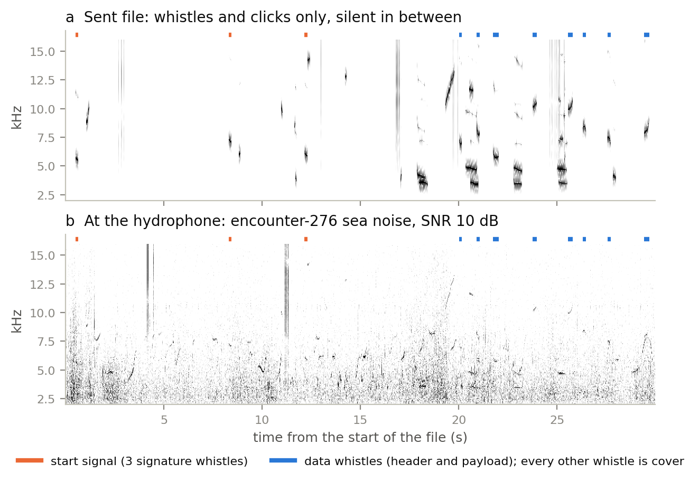
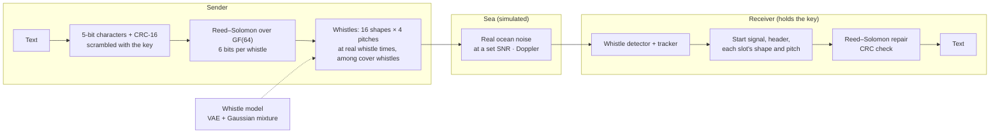
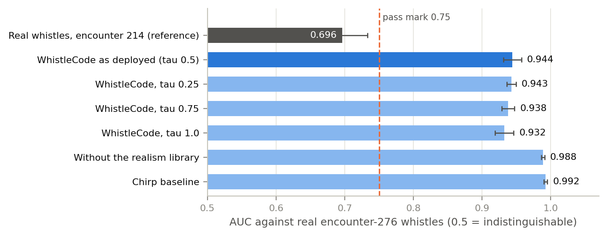
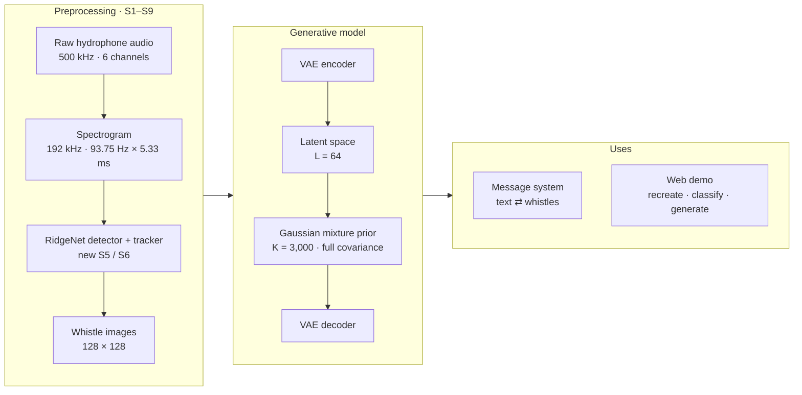

<div align="center">

# Falsetto

**Short text messages hidden in synthetic false killer whale whistles**

A sender turns a line of text into a stretch of whistling meant to pass for a group of false killer whales. A receiver that holds the shared key turns the recording back into the exact text. Tested in simulation only.

[](https://github.com/anonymus-k-dot/cetacean_whistle_reproduction/actions/workflows/ci.yml)
[](LICENSE)



<sub>A sent message (whistles and clicks only), then the same message at the hydrophone in real sea noise at 10 dB SNR.</sub>

</div>

---

Falsetto is a biomimetic underwater messaging system. Its signals imitate an animal, so that a listener who picks them up should take them for wildlife and ignore them. Each data whistle carries 6 bits and is a new sample from a generative model of false killer whale (*Pseudorca crassidens*) whistles, trained on public NOAA recordings. It was built as an independent student course project in 2026 ([about this project](#about-this-project)).

The generative model follows the VAE-GMM method of Park *et al.*, *"A Generative Model for Cetacean Whistles Using Variational Autoencoder and Mixture of Gaussians"*, *IEEE Access* 14 (2026), 27877–27894, [doi:10.1109/ACCESS.2026.3664765](https://doi.org/10.1109/ACCESS.2026.3664765). It was reimplemented here from the paper and checked against the paper's reported results. That paper names biomimetic communication as the use for its model; the message system built on it here is this project's own work. **The project is not affiliated with or endorsed by the paper's authors or their institution.**

The code and older documents call the message system WhistleCode, its first working name.

### At a glance

- **What it does.** Text is packed into 5-bit characters and protected by CRC-16 and Reed–Solomon over GF(64). Each code symbol is one whistle: one of 16 learned whistle shapes at one of 4 key-chosen pitches. The data whistles are placed at real false killer whale whistle times, among cover whistles and clicks. A median 41-character message takes 142 s, about 1.2 bit/s.
- **Does it deliver?** In simulation, yes in a clean channel (200 of 200 messages) and mostly in real sea noise: 84.5 % exact at 10 dB in a held-out encounter, against a pass mark of 95 % set before the test. No false message was accepted in 7,900 tries.
- **Does it pass for whales?** Not yet. A trained discriminator cannot tell the whistle timing from real whistling on its own (AUC 0.440; the mark was ≤ 0.60), but it can inside sea noise (0.684). A whistle-shape discriminator tells coded whistles from real ones (AUC 0.944; the mark was ≤ 0.75).
- **What it stands on.** A VAE-GMM model trained on 63,490 whistles from one encounter of NOAA's DCLDE 2022 release, and a new compact whistle detector, RidgeNet, which builds the training images and runs in the receiver. Against Park *et al.*'s reported numbers, the network matches exactly (decoder: 368,097 parameters, 557.3 MFLOPs) and SSIM matches (0.990 against 0.986). PSNR (32.8 dB against 44.5 dB) and conditional-generation precision (65–77 % against 83–91 %) do not.
- **Not done.** No message has been played through a speaker or into water.

## Contents

[Project status](#project-status) · [How it works](#how-it-works) · [Results in simulation](#results-in-simulation) · [What is new](#what-is-new) · [The whistle model](#the-whistle-model) · [Dataset record](#dataset-record) · [Getting started](#getting-started) · [Command reference](#command-reference) · [Repository layout](#repository-layout) · [Research integrity](#research-integrity) · [Limitations](#known-limitations) · [Documentation](#documentation) · [About this project](#about-this-project) · [Citation](#citation)

## Project status

*As of 23 November 2026.*

| Component | State | Notes |
|---|---|---|
| Message system, test campaign v1 | **Complete** | [Results](whistlecode/paper/RESULTS.md): 3 of 6 pass marks met; failures reported as measured |
| Doppler and clock-drift correction | **Adopted** (21 Nov) | Measured on development noise only; campaign v2 will test it on held-out noise |
| Whistle shapes that pass as real | **Open** | Next step: find what gives the shapes away (shape AUC 0.944) |
| Real acoustic test | **Open** | No message has been played through a speaker and recorded yet |
| Whistle model: preprocessing (S1–S9) | **Complete** | 1,415 / 1,415 files processed, 0 failed; 180,154 images from 8 encounters |
| Whistle detector (S5/S6) | **Adopted** | `ridgenet-v2c`: 14,209 weights, trained only on synthetic whistles |
| Whistle model: VAE training (run V1) | **Complete** | 150 / 150 epochs on encounter 191 (Colab A100 80 GB); epochs 102–150 resumed on 2026-11-20 |
| Whistle model: Gaussian mixture, K = 3,000 | **Fitted for both checkpoints** | Post-fit checks passed |
| Whistle model checked against Park *et al.* | **Complete for both checkpoints** | Tables 1, 3 and 6; Figs. 7–10 and 12; Figs. 13–14 for epoch 150. Fig. 11 and Table 2 for epoch 150 at K = 3,000 only; Tables 4, 5 not computed (maintainer's decision) |
| Web demo | **Runs locally** | Encode, Decode and Record, then Try it for the whistle model (Nyx or Delphi); can be self-hosted with Docker and Tailscale Funnel. Retold as Falsetto: the film is drawn from real records in WebGL ([plan](web/PLAN.md)) |

## How it works



1. **Sender.** A text message is packed into a 5-bit alphabet (raw UTF-8 for anything outside it), checked by CRC-16, scrambled with the key and protected by Reed–Solomon over GF(64). Each 6-bit symbol becomes one whistle: one of 16 mixture components of the whistle model gives the shape (4 bits), and one of 4 key-chosen pitches gives the rest (2 bits). Every data whistle is a fresh sample from its component, so no shape repeats exactly.
2. **Timing.** Whistle times are borrowed from real false killer whale recordings. Data whistles sit among cover whistles, recorded voices and clicks, at slots that only the key reveals.
3. **Receiver.** It runs the whistle model's own detector and tracker, finds the three-whistle start signal, reads each whistle at its key-derived slot, and repairs the message using erasures. Text is released only if the CRC check passes.

The sent file contains whistles and clicks only. In the tests the sea is simulated by adding real ocean noise from encounters that the model never saw, at the receiver.

## Results in simulation

<table>
<tr>
<td width="50%"></td>
<td width="50%"></td>
</tr>
<tr>
<td><sub>Messages decoded exactly against SNR, in two noise encounters and for a 16-chirp baseline. The baseline needs about 10 dB more SNR for the same success.</sub></td>
<td><sub>The whistle-shape test (E7), the result that most needs work. A trained discriminator scores how well it tells each set from real whistles (0.5 means it cannot). Real whistles from another encounter score 0.696; the coded whistles score 0.93–0.94, over the 0.75 pass mark.</sub></td>
</tr>
</table>

The pass marks were set in the plan before any test ran, and the results are reported as measured, failures included. All tests use the epoch-101 model and a frozen configuration.

| Test | Pass mark | Measured | Verdict |
|---|---|---|---|
| Clean channel (E1) | 100 % exact | 200 / 200 | Pass |
| Final run: encounter-276 noise, 10 dB | ≥ 95 % exact | 84.5 % (97 % for messages under 60 data whistles) | Fail |
| False messages: wrong text, wrong key, or no message present | 0 | 0 in 7,900 tries (3,700 + 3,700 + 500) | Pass |
| Rhythm discriminator, stream on its own (E9) | AUC ≤ 0.60 | 0.440 | Pass |
| Rhythm discriminator, inside encounter-276 noise | AUC ≤ 0.60 | 0.684 | Fail |
| Whistle-shape discriminator (E7) | AUC ≤ 0.75 | 0.944 (two real encounters: 0.696) | Fail |

A median compact-text message (41 characters) takes 142 s of airtime, about 1.2 bit/s. In campaign v1, closing speeds of ±2 m/s cut success to 14–22 %. The receiver has since gained Doppler and clock-drift correction (second round, WC-R2). On the encounter-214 development noise it decodes 49–50 of 50 messages at every speed from −3 to +3 m/s; campaign v2 will test it on encounter 276. The open items are echoes, whistle shapes that a trained discriminator can still tell from real ones, and a real speaker-to-hydrophone test. Full tables are in [`RESULTS.md`](whistlecode/paper/RESULTS.md), the method in [`TEST_PROTOCOL.md`](whistlecode/paper/TEST_PROTOCOL.md), and whom the system is meant to fool, and what may be claimed, in [`THREAT_MODEL.md`](whistlecode/THREAT_MODEL.md).

> **Responsible use.** The system has been tested in simulation only. Playing synthetic whistles near wild animals requires the appropriate permits.

## What is new

Published biomimetic schemes modify a whistle-like carrier, replay or rearrange recorded calls, synthesise calls from hand-made signal models, or train a network to hide bits inside a carrier. Here the symbols are the mixture components of an explicit density model of one species' whistles, and every data whistle is a fresh sample from its component. None of the published systems read so far works this way, but the literature search is not finished: only one index was searched, and some papers were read at abstract level only ([`RELATED_WORK.md`](whistlecode/RELATED_WORK.md), sections 4, 5 and 7).

What is not new: imitating false killer whales, a deep-learning receiver, cover calls, and the steganography framing all have published precedents. The design trades rate for naturalness: about 1.2 bit/s, against 20–300 bit/s for schemes that put bits inside each call, and several published schemes have lake or sea trials where this one has none.

## The whistle model

The message system's whistles come from a generative model of false killer whale whistles, built with the method of Park *et al.* (2026). It is trained on the paper's source collection: recordings from the 2017 HICEAS survey, released by NOAA as part of DCLDE 2022. The selection of files is different. All eight encounters of ship 1705 are processed (1,415 files), and the model is trained on one of them. Each result records the SHA-256 of its inputs, its configuration and its git commit, so it can be traced back to the raw files and the checkpoint that produced it.

### Method



Whistle contours are extracted from spectrograms and rendered as 128 × 128 images. A variational autoencoder (latent dimension L = 64, with an adversarial critic) learns a latent space, and a full-covariance Gaussian mixture models that space as an explicit prior that can be sampled.

| Stage | Operation | Basis |
|---|---|---|
| S1 | Read channel 0 of the 6-channel, 500 kHz FLAC | Decision (the paper is silent) |
| S2 | Polyphase resampling to 192 kHz (Kaiser FIR, 48/125) | Paper; filter is a decision |
| S3 | High-pass above 2 kHz (4th-order Butterworth, zero-phase) | Paper; filter is a decision |
| S4 | STFT: Hamming, 2,048 points, 50 % overlap, giving 93.75 Hz × 5.333 ms | Paper |
| S5 | RidgeNet: per-node whistle confidence, 2–24 kHz | **New design** (paper's ref. [31] not available) |
| S6 | Tracker: confidence map to individual whistle contours | **New design** (refs. [32], [33] not available) |
| S7 | One time–frequency vector per whistle | Paper |
| S8 | Centre the whistle and re-render at a 12 kHz baseband; reject tracks > 128 frames | Paper; details are decisions |
| S9 | 128 × 128 linear-magnitude image, normalised to its maximum | Paper |

The model has an encoder of 589,408 parameters, a decoder of 368,097 and a critic of 184,609. The latent means of all training images are fitted by full-covariance EM. Generation samples a component, draws a latent vector and decodes it. Conditional generation (the paper's Table 3) adds component weights and a rejection step. Each image is turned back into sound by the paper's Fig. 2 chain: threshold 0.05, then contour, then a constant-amplitude tone at the whistle's own centre frequency.

### Checked against Park *et al.*

Because the model follows a published method, its numbers can be set beside the paper's to check the implementation. All results in this section are for the epoch-101 checkpoint, trained on 63,490 images from encounter 191. The full side-by-side record is in [`post_training/out/paper_comparison.csv`](post_training/out/paper_comparison.csv).

<table>
<tr>
<td valign="top" width="52%">

**Table 1: reconstruction (L = 64)**

| Metric | This work | Paper |
|---|---:|---:|
| MSE ↓ (per-image sum, see note) | 8.52 | 0.578 |
| PSNR (dB) ↑ | 32.84 | 44.53 |
| SSIM ↑ | 0.9898 | 0.9861 |
| KL (latent) | 860.6 | 43.19 |

**Table 3: conditional generation, 13 conditions**

| Metric | This work | Paper |
|---|---:|---:|
| Recall | 88.7–95.9 % | 98.2–99.3 % |
| Precision | 64.9–77.1 % | 82.7–90.8 % |
| F1 | 75.0–83.2 % | 90.1–94.4 % |

**Table 6: decoder cost (RTX 5060 Laptop GPU)**

| Measure | This work | Paper |
|---|---:|---:|
| Parameters | 368,097 | 368 k |
| FLOPs | 557.3 M | 557 M |
| Latency, B = 1 | 1.78 ms | 1.7 ms |
| Per image, B = 16 (warm GPU) | 0.120 ms | 0.11 ms |

</td>
<td valign="top" width="48%">


<sub>**The paper's Fig. 12, recomputed.** ln FFD between real (rows) and generated (columns) whistles. Every diagonal entry is its row's minimum, and the paper's near pairs 4/5 and 7/8 reappear.</sub>


<sub>Whistles sampled from 25 components of the fitted mixture and decoded by the VAE (the paper's Fig. 7 protocol).</sub>

</td>
</tr>
</table>

**Reading the numbers.** Only one of the four Table 1 metrics matches the paper: SSIM. MSE is about 15 times the paper's, PSNR is 11.7 dB lower, and the latent KL is about 20 times higher. The parameter and FLOP counts in Table 6 match because the architecture is the same, so they show that the network was built correctly, not that it was trained as well as the paper's. The likely causes of the gap are recorded but untested ([training spec](resources/TRAINING_SPECIFICATION.md) §3.10):

- Far fewer optimiser updates. Epoch 101 had 1,111 updates and epoch 150 has 1,650, against the paper's ≈ 76,800. The large single-GPU batch causes this.
- The BCE reconstruction loss.
- Different images, from the new detector and a single encounter.

Table 3 trails the paper in value but matches it in structure. Table 6's paper-protocol timing includes the laptop GPU waking from idle after each 0.5 s pause, so a warm-GPU supplement is reported as well.

**Epoch 150 (Delphi)** was evaluated the same way ([`paper_comparison_V1_L64_b1e-4_critic_E191_epoch150.csv`](post_training/out/paper_comparison_V1_L64_b1e-4_critic_E191_epoch150.csv), figures in [`models/vaegmm/V1_L64_b1e-4_critic_E191_epoch150/figures/`](models/vaegmm/V1_L64_b1e-4_critic_E191_epoch150/figures/)). Table 1: MSE 5.42, PSNR 34.81 dB, SSIM 0.9934, KL 757.7, so again only SSIM matches. Table 3: recall 84.7–96.9 %, precision 74.5–79.7 %, F1 79.3–85.8 %, and every Fig. 12 diagonal entry is still its row's minimum. Table 6: the same decoder; 0.114 ms per image at B = 16 on a warm GPU. Fig. 11 at K = 3,000 only: silhouette 0.091 against the paper's 0.401 and Davies-Bouldin 1.48 against 0.77, so its latent clusters are much less separated. Table 2 at K = 3,000 only: FID₁ 29.5 against the paper's 2.6–4.4, and precision and recall of 10 % and 3 % on raw images (65 % and 53 % thresholded at 0.1) against about 90 % and 87 %; two halves of the real images score about 87 % against each other, so the gap lies in the generated images. Figs. 13–14 (the paper's appendix: six more conditions, 100 whistles each) are drawn for epoch 150 too ([Fig. 13](models/vaegmm/V1_L64_b1e-4_critic_E191_epoch150/figures/fig13_conditional.png), [Fig. 14](models/vaegmm/V1_L64_b1e-4_critic_E191_epoch150/figures/fig14_conditional.png)); every drawn whistle meets its condition, and the shapes follow the paper's.

*Note on MSE.* The paper's MSE column is read as a per-image sum of squared errors, because that is what its PSNR values imply (PSNR = 10 log₁₀(16384 / MSE)); see the [training spec](resources/TRAINING_SPECIFICATION.md) §3.7.

### Trained checkpoints

V1 was trained on a single A100 with batch 5,772 and linearly scaled learning rates (6.442e-3 for the VAE, 1.288e-3 for the critic). Each epoch is 11 updates and took about 130 s. Training stopped at epoch 101 and was later resumed to completion. Both checkpoints are kept, and the web demo can use either; it calls them Nyx (epoch 101) and Delphi (epoch 150).

| | **Epoch 101** | **Epoch 150** |
|---|---|---|
| Checkpoint | epoch 101 of 150 | epoch 150 of 150 |
| Reconstruction loss *(training log)* | 171.2 | 161.9 |
| KL *(training log)* | 830.6 | 738.2 |
| GMM, K = 3,000 | converged in 111 iterations; mean log-likelihood 221.71 | converged in 150 iterations; mean log-likelihood 211.04 |
| Post-fit check (feature FFD / nearest-neighbour ratio) | 4.63 / 1.02 (passed) | 4.47 / 1.04 (passed) |
| Used for | message system, comparison with the paper, web demo (default) | web demo |
| Folder | `models/vaegmm/V1_L64_b1e-4_critic_E191/` | `models/vaegmm/V1_L64_b1e-4_critic_E191_epoch150/` |

For scale, the reconstruction loss is a per-image BCE sum. A perfect reconstruction scores 141.6 and always predicting the average image scores 421.9. A nearest-neighbour ratio near 1 means generated latents are no closer to training latents than those are to one another, so the mixture is not copying them.

### Whistle detector

The paper's detector is not available, so S5 is a new, compact network, **RidgeNet** (about 14k parameters, fully convolutional). It is trained only on synthetic whistles laid over real ocean backgrounds. Six versions were compared on identical synthetic streams, whistle by whistle. **v2c** was adopted: it is v1's network with a label-free correction for faint real whistles hidden in the training backgrounds. The same detector reads the whistles in the message receiver.

| Held-out synthetic test | v1 | **v2c** |
|---|---:|---:|
| Track recall, visible fundamentals | 0.704 | **0.729** |
| Recall at 5–10 dB local SNR | 0.519 | **0.647** |
| Paired whistle-by-whistle wins / losses | — | **+28 / −14** (p = 0.044) |
| False tracks per minute, contamination-free negatives | 0.00 | 0.00 |

These numbers describe the synthetic task only: no annotated 2017 data exists, so no real-data precision or recall is claimed for the 2017 recordings.

A 5–24 kHz variant was also scored on real annotated data, the nine DCLDE 2011 test files of Li *et al.* (2023), with their scoring protocol ([`mod_detector_5_24/`](mod_detector_5_24/README.md)):

| DCLDE 2011, species average | Precision | Recall | F1 |
|---|---:|---:|---:|
| RidgeNet 5–24 kHz (this work, out of domain) | 53.6 % | 84.9 % | 65.2 % |
| Li *et al.* 2023, best system (5–50 kHz, their setup) | 88.8 % | 85.8 % | 87.2 % |

The bands and setups differ, so the second row is context, not a head-to-head comparison. RidgeNet finds about as many whistles but produces many more false detections. The full experiment record is in the [technical reference](docs/TECHNICAL_REFERENCE.md#s5-detector-experiments).

## Dataset record

All eight false killer whale encounters of ship 1705 (R/V *Lasker*) in DCLDE 2022 were processed with detector `ridgenet-v2c`. The build ran on 2026-10-21 at commit `8cf3ed4`, with no uncommitted code changes. The VAE is trained on **encounter 191 only**, a decision made to save compute ([training spec](resources/TRAINING_SPECIFICATION.md) §2.1). The message system uses encounter 214 as development noise and encounter 276 as held-out test noise. The other five encounters stay processed and available.

| Encounter | Files | Tracks after S6 | Rejected in S8 (> 128 frames) | Images |
|---|---:|---:|---:|---:|
| 191 | 363 | 67,236 | 3,746 | 63,490 |
| 214 | 124 | 6,825 | 148 | 6,677 |
| 276 | 120 | 14,653 | 502 | 14,151 |
| 279 | 145 | 36,171 | 2,654 | 33,517 |
| 280 | 104 | 16,972 | 1,169 | 15,803 |
| 308 | 162 | 23,599 | 1,705 | 21,894 |
| 331 | 331 | 20,903 | 464 | 20,439 |
| 416 | 66 | 4,253 | 70 | 4,183 |
| **Total** | **1,415** | **190,612** | **10,458 (5.5 %)** | **180,154** |

The median whistle lasts 40 frames (213 ms). The whole build took 71.5 minutes, about 3.0 s per 60 s file, on an RTX 5060 Laptop GPU. The paper's 228,673 vectors from 2,486 files are not a target and not comparable, because the detector and the file selection differ.

## Getting started

**Requirements.** You need Python 3.11 or newer. A CUDA GPU is optional for the message system and the web demo, and recommended for training and the GMM fit. The dataset was built on an RTX 5060 Laptop GPU (8 GB) and the VAE was trained on an A100 80 GB. For a GPU, install `torch` and `torchvision` from the PyTorch index for your CUDA version first.

```bash
git clone https://github.com/anonymus-k-dot/cetacean_whistle_reproduction.git
cd cetacean_whistle_reproduction
pip install -r requirements.txt -r whistlecode/requirements.txt -c constraints.txt
git config core.hooksPath .githooks   # pre-commit checks: work log, secrets, lint

python -m pytest whistlecode/tests   # message-system suite
python -m pytest                     # whistle-model suite
python tools/repo.py check           # lint, configs, secrets, links, checksums and both suites
```

**What runs from a clone.** The code, configurations, detector checkpoints, both VAE checkpoints (`final.pt`) and all evaluation records and figures are in git. The large files are not:

| What | From a clone? | What else it needs |
|---|---|---|
| Both test suites and `tools/repo.py check` | Yes | Nothing (the tests use small synthetic fixtures) |
| Evaluation records and figures | Yes | Nothing (they are in git) |
| Sending and receiving messages (`send`, `receive`, the page's Encode and Decode) | No | The model's `gmm.npz` and the codebook built from it; the simulated sea also needs the encounter 214 and 276 audio (about 45 GB) |
| Recreating the whistles of a recording (`infer`, the web demo's Try it) | Yes | Nothing |
| Generating new whistles of a type, whistle families | No | The model's `gmm.npz`: about 100 MB per model, not in git |
| Rebuilding the dataset, retraining, refitting the mixture | No | Raw audio: about 68 GB for encounter 191, about 270 GB for all eight |

GMM refits from the same dataset are bit-identical.

**Raw audio** (about 190 MB per 60 s file) comes from NOAA's DCLDE 2022 release, ship 1705, at `gs://noaa-passive-bioacoustic/dclde/2022/dclde_2022_1705/audio/`. [`metadata/whale_encounters_1705.csv`](metadata/whale_encounters_1705.csv) gives each encounter's first and last file. Place each encounter in `encounter_<id>_audio/` at the project root. Every file is checked against the SHA-256 manifest in [`metadata/manifest_all.csv`](metadata/manifest_all.csv), and files that are not in it are refused.

**Run the web demo** (the illustrated introduction, then Encode, Decode and Try it):

```bash
python whistle.py model-status --all          # which trained files each model has
python whistlecode/whistlecode.py serve       # http://127.0.0.1:8000
```

To put it on the internet from your own computer, follow [`deploy/README.md`](deploy/README.md) (Docker + Tailscale Funnel).

## Command reference

All commands run from the project root. `--help` lists every option, and the [technical reference](docs/TECHNICAL_REFERENCE.md#commands) documents the whistle-model commands in full.

```bash
# Messages
python whistlecode/whistlecode.py send --help                          # text -> WAV of whistles
python whistlecode/whistlecode.py channel --help                       # play a WAV into real ocean noise
python whistlecode/whistlecode.py receive --help                       # recording -> text
python whistlecode/whistlecode.py export-film                          # the page film's data from real records -> web/film/

# Whistle model: preprocessing, checks first, then the final dataset
python whistle.py run --run-id check_val5 --set val5 --storage debug   # check run -> preprocessing_checks/
python whistle.py validate-run --run-id check_val5                     # lineage, output validity, cross-stage counts
python whistle.py build-dataset                                        # final dataset -> preprocessed/ (resumable)
python whistle.py validate-dataset

# Whistle detector (synthetic data only)
python whistle.py build-backgrounds                                    # real-background banks
python whistle.py build-ridge-masks                                    # label-free masks of faint real whistles
python whistle.py train --version ridgenet-v3                          # a new version; checkpoints are never overwritten
python whistle.py eval-synth --version ridgenet-v2c --split test
python whistle.py compare-synth --versions ridgenet-v1 ridgenet-v2c --split test

# VAE-GMM
python whistle.py vae-gates                                            # gates G1, G2, G6 (no training)
python whistle.py train-vae --experiment V1                            # --resume continues a run
python whistle.py fit-gmm --experiment V1 --K 3000
python post_training/gmm_check.py                                      # post-fit check (--run-id for another run)
python whistle.py vae-eval recon --experiment V1                       # also: components, conditional, cost, figures

# Inference
python whistle.py infer recording.wav                                  # whistles, recreations, types, sound
python whistle.py generate --n 8 --condition 2                         # new whistles under a Table 3 condition
```

## Repository layout

```
├── whistlecode/            the message system: sender, channel, receiver, tests, experiments, plan, results
├── whistle.py              CLI entry point of the whistle model
├── src/whistlepipe/        the whistle model: preprocessing S1–S9, detector, VAE-GMM, inference, sonification, web API
├── configs/                pipeline · detector · vaegmm · inference (TOML; [paper] sections are locked)
├── resources/              Park et al.'s paper and the preprocessing / training specifications
├── metadata/               encounter tables and the SHA-256 manifest of every raw file
├── models/
│   ├── detector/           RidgeNet v1–v2e with evaluations (v2c adopted)
│   └── vaegmm/             training runs, GMM fits, evaluation records and figures
├── post_training/          checks after training; comparison records against the paper
├── colab/                  Colab notebook and code bundle for the VAE training run
├── web/                    project web page: illustrated introduction, Encode, Decode, Try it; the film's data (film/)
├── deploy/                 self-hosting with Docker + Tailscale Funnel
├── cluster/                course lab: running the demo on the college's teaching cluster
├── mod_detector_5_24/      5–24 kHz detector variant for the DCLDE 2011 benchmark
├── tests/                  whistle-model tests (small synthetic fixtures; no dataset needed)
├── docs/                   technical reference, architecture, index; course/ (course deliverables)
├── project/                how the project is run: workflow, releases, registers
├── tools/repo.py           one command for every check, plus lock, health and release-check
├── .github/                CI workflow and security policy
├── .githooks/              pre-commit checks (work log, secrets, lint)
├── pyproject.toml          version, Python version, lint and test settings
├── requirements.txt        dependencies (constraints.txt: the exact versions in use)
├── WORKLOG.md              what is planned, waiting and done
└── CHANGELOG.md            changes per release
```

These are not in git: `encounter_<id>_audio/` (raw audio, never written to), `preprocessed/` (the dataset), `preprocessing_checks/`, `data/`, `runs/`, `whistlecode/outputs/`, `docs/explainers/` and `docs/private/`. Where each comes from and how it is backed up: [`project/STORAGE.md`](project/STORAGE.md).

## Research integrity

**Pass marks before results.** The message system's pass marks and test protocol were frozen in [`PLAN.md`](whistlecode/PLAN.md) before the runs they govern, and every verdict is reported as measured. The claims that may be made today, and the evidence for each, are listed in [`THREAT_MODEL.md`](whistlecode/THREAT_MODEL.md) and [`project/TRACEABILITY.md`](project/TRACEABILITY.md).

**What comes from Park *et al.* and what does not.** Preprocessing stages S1–S4 and S7–S9, the VAE-GMM architecture and its evaluation protocol follow the paper. The paper's S5 detector (its ref. [31]) and S6 tracker (refs. [32], [33]) are described only in the authors' own two-page Korean conference papers (KICS Winter Conference 2024; KIMST Annual Conference 2024), which were not obtained. S5 and S6 here are new designs that meet the functional requirements in [spec](resources/PREPROCESSING_SPECIFICATION.md) §11, and they are not claimed to be equivalent to the originals. The message system, its threat model and its tests are this project's own.

**Related work used.** P. Li *et al.*, "Learning deep models from synthetic data for extracting dolphin whistle contours", arXiv:2005.08894 (2020), is the paper's ref. [30], not its detector. It was used only as methodological inspiration (injecting known shapes into whistle-free backgrounds; per-node confidence maps), and none of its numbers were adopted. The DCLDE 2011 benchmark above follows Li *et al.*, *J. Acoust. Soc. Am.* (2023), [doi:10.1121/10.0020274](https://doi.org/10.1121/10.0020274). The biomimetic-communication work the message system is compared with is reviewed in [`RELATED_WORK.md`](whistlecode/RELATED_WORK.md).

**Evidence tags.** Every value in `configs/*.toml`, `whistlecode/config.toml` and the code docstrings carries a tag:

- `[EXPLICIT]`, `[IMPLIED]` and `[UNSPECIFIED]` come from the specification and refer to the paper.
- `[DECISION]` marks a choice made here, either because the paper leaves the point open or because the message system is new; it is never paper evidence.
- `[REPLACEMENT]` marks part of the new S5/S6 design.

The `[paper]` sections of `pipeline.toml` and `vaegmm.toml` are locked, and the code refuses to run if any value differs from the specification.

**Where the whistle model departs from the paper.** Each departure is recorded in the specifications and in every run's `train_info.json`:

| Topic | Paper | Here |
|---|---|---|
| Data | 2,486 files from DCLDE 2022 (selection not stated) | 1,415 files from the same collection (ship 1705, 8 encounters); model trained on encounter 191 (363 files, 63,490 images) |
| Detector and tracker | Refs. [31]–[33] | RidgeNet + tracker (new designs, see above) |
| Batch and learning rate | 7 × 128 = 896 | 5,772 on one GPU, with learning rates scaled linearly (lr × B / 896) |
| Mixture size | K = 10,000 | K = 3,000 |
| Determinism | — | cuDNN autotuning on: same maths, not bit-identical between runs |

**Lineage.** Each raw file's SHA-256 is verified before processing, and the raw folders are opened read-only. Every run records its full configuration and hash, its software versions, the detector checkpoint hash and the git commit, including whether there were uncommitted changes. The code refuses to overwrite an existing run, dataset or GMM fit. Each reported number is mapped to the record that holds it in [`project/TRACEABILITY.md`](project/TRACEABILITY.md).

## Known limitations

- **Simulation only.** No message has been played through a speaker or into water. The simulated sea adds real ocean noise and Doppler, but echoes still cost messages, and a projector's own distortion has never been tested.
- **The whistle shapes do not yet pass as real.** A trained discriminator tells coded whistles from real ones (AUC 0.944, against 0.696 between two real encounters), and the timing gives the stream away inside sea noise (0.684).
- **Held-out delivery misses its mark.** 84.5 % exact at 10 dB in encounter-276 noise, against 95 %. The new drift correction has been measured on development noise only.
- **Slow, and not secret.** About 1.2 bit/s. The key scrambles the message but is not encryption, and there is no protection against replayed or forged messages ([`THREAT_MODEL.md`](whistlecode/THREAT_MODEL.md)).
- **The whistle model is below the paper's reconstruction quality.** Only SSIM matches in Table 1, and Table 3 values trail the paper's even though its structure matches. Epoch 150 does better on Table 1 but still matches only SSIM, and it has not been used for messages.
- **No real-data detector accuracy is known for the 2017 recordings.** No annotated 2017 data exists. The detector is nearly blind below about 5 dB local SNR and can swap identities in very dense crossings. On the annotated DCLDE 2011 files, the 5–24 kHz variant's precision is 53.6 %.
- **Reduced scope.** The VAE is trained on one encounter. K is 3,000. Fig. 11 and Table 2 are computed for epoch 150 at K = 3,000 only, and Tables 4 and 5 are not computed. Only one hydrophone channel is used (channel 0, chosen arbitrarily).
- **Not peer reviewed.** This is a course project; no part of it has been through external review.

The full, observed list for the whistle model is in the [technical reference](docs/TECHNICAL_REFERENCE.md#known-limitations).

## Documentation

| Document | Contents |
|---|---|
| [`whistlecode/PLAN.md`](whistlecode/PLAN.md) | Message-system design, experiments and frozen pass marks |
| [`whistlecode/THREAT_MODEL.md`](whistlecode/THREAT_MODEL.md) | Whom the system is meant to fool, what it protects, and what may be claimed |
| [`whistlecode/RELATED_WORK.md`](whistlecode/RELATED_WORK.md) | Published biomimetic communication schemes, and what appears new here |
| [`whistlecode/paper/RESULTS.md`](whistlecode/paper/RESULTS.md) | Test campaign v1: verdicts, tables, figures |
| [`resources/PREPROCESSING_SPECIFICATION.md`](resources/PREPROCESSING_SPECIFICATION.md) | Whistle model: paper evidence for every preprocessing stage, with a parameter table |
| [`resources/TRAINING_SPECIFICATION.md`](resources/TRAINING_SPECIFICATION.md) | Whistle model: discrepancy report, corrected training specification, decisions, deviations, gates |
| [`docs/TECHNICAL_REFERENCE.md`](docs/TECHNICAL_REFERENCE.md) | Whistle model: dataset layout, lineage, detector design and experiments, training record, inference, commands |
| [`web/README.md`](web/README.md) | Running the project page; Encode, Decode and Record; serving two computers |
| [`deploy/README.md`](deploy/README.md) | Self-hosting with Docker and Tailscale Funnel |
| [`mod_detector_5_24/README.md`](mod_detector_5_24/README.md) | The 5–24 kHz detector variant and the DCLDE 2011 benchmark |
| [`docs/ARCHITECTURE.md`](docs/ARCHITECTURE.md) | How the components, modules, web server and deployment fit together |
| [`docs/INDEX.md`](docs/INDEX.md) | Every document, and what each is the authority on |
| [`project/README.md`](project/README.md) | How the project is run: workflow, tests and CI, releases, and the records of experiments, models, data, decisions and incidents |
| [`CHANGELOG.md`](CHANGELOG.md) · [`WORKLOG.md`](WORKLOG.md) | Changes per release · what is planned, waiting and done |

## About this project

This is a student project, built in 2026 for an eight-week acoustics project course, and it has one maintainer ([`anonymus-k-dot`](https://github.com/anonymus-k-dot)). Much of the code and documentation was written with Claude Code, an AI coding assistant, at the maintainer's direction; the decisions, approvals and commits are the maintainer's. Every number reported for this project comes from a recorded run, and [`project/TRACEABILITY.md`](project/TRACEABILITY.md) says which.

## Citation

To cite this project, use GitHub's "Cite this repository" button, which reads [`CITATION.cff`](CITATION.cff). If you use the whistle model, please also cite the paper whose method it follows:

```bibtex
@article{park2026whistles,
  author  = {Park, Geun-Ho and Ahn, Jongmin and Kim, Wanjin and Kim, Insoo and Lee, Dong-Hun},
  title   = {A Generative Model for Cetacean Whistles Using Variational Autoencoder and Mixture of Gaussians},
  journal = {IEEE Access},
  volume  = {14},
  pages   = {27877--27894},
  year    = {2026},
  doi     = {10.1109/ACCESS.2026.3664765}
}
```

## Licence and acknowledgements

- **Code.** [Apache License 2.0](LICENSE), with a [`NOTICE`](NOTICE) that lists what it does not cover. Licences of everything third-party: [`project/LICENSING.md`](project/LICENSING.md). Security policy: [`.github/SECURITY.md`](.github/SECURITY.md).
- **Paper.** The copy of Park *et al.* in `resources/` is licensed CC BY-NC-ND 4.0, as stated on its first page.
- **Data.** The recordings are NOAA's DCLDE 2022 release (HICEAS 2017, R/V *Lasker*). They are public, are not redistributed here, and should be credited to NOAA when used.
- **Web assets.** Fonts and media are credited in [`web/CREDITS.md`](web/CREDITS.md).
