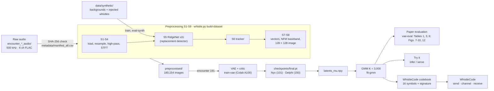
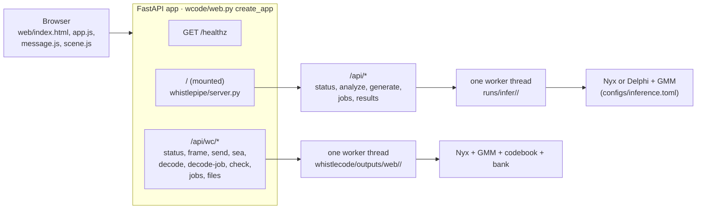
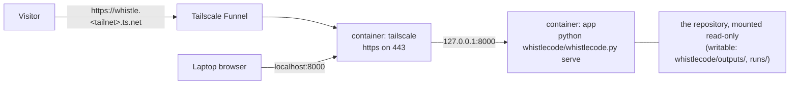

# Architecture

How the parts of the project fit together: the data flow, the code modules, the web server and the deployment. Update this page when a component, command or route is added or moved (Definition of Done, `project/WORKFLOW.md`). Commands in full: [`TECHNICAL_REFERENCE.md`](TECHNICAL_REFERENCE.md#commands). An interactive map of the code can be drawn locally in `floorplan/` (not in git).

## 1. Data flow, end to end

Every arrow that produces a file also writes its lineage: the configuration and its hash, the input files' hashes, the software versions and the git commit (`src/whistlepipe/storage.py`). Nothing is overwritten.

## 2. Code modules

### `src/whistlepipe/`: the whistle model (entry point `whistle.py`)

| Module | Job |
|---|---|
| `cli.py` | the `python whistle.py <command>` command line; VAE-GMM commands come from `vaegmm/cli.py` |
| `config.py` | loads `configs/*.toml`, locks the `[paper]` values, hashes configurations |
| `audio.py`, `dsp.py` | S0-S4: find and read raw files read-only, resample, high-pass, STFT |
| `detector/` | S5: the detector contract (`interface.py`), input conditioning, RidgeNet |
| `tracking.py` | S6: confidence map to whistle tracks |
| `representation.py` | S7-S9: whistle vectors, NFM baseband, 128 × 128 images |
| `pipeline.py`, `storage.py`, `checks.py` | runs S1-S9 per file with diagnostics, lineage and the storage policy; independent checks |
| `manifest.py`, `dataset.py` | the raw-file manifest; the final dataset, one folder per encounter |
| `synth/`, `train.py`, `evaluate.py` | synthetic training data, detector training, detector evaluation (synthetic only) |
| `vaegmm/` | VAE and critic (`models.py`), losses, training, GMM (EM), features, metrics, conditional generation, gates G1-G6, evaluation |
| `infer.py`, `sonify.py` | Try it: a recording to its whistles, the model's images and sound; image to sound |
| `server.py` | the page and the Try it API (`/api/...`) |
| `guard.py` | limits for a public server, used by both servers: request sizes enforced while the body arrives, uploads at once, one-channel block reading of uploads, job folders pruned oldest first |
| `webexport.py`, `ratecheck.py`, `plotting.py` | page examples, sample-rate check, diagnostic figures |

### `whistlecode/wcode/`: WhistleCode (entry point `whistlecode/whistlecode.py`)

| Module | Job |
|---|---|
| `config.py` | loads and checks `whistlecode/config.toml`; the release version for `/healthz` |
| `repro.py`, `model.py` | imports the whistle model read-only; checks the checkpoint → latents → GMM chain |
| `keys.py`, `framing.py`, `format2.py`, `fec.py` | key and nonce streams; text to symbols (format v2); Reed-Solomon with erasures |
| `codebook.py`, `contour.py`, `synth.py` | the 16-symbol alphabet from GMM components; contours; contour to whistle audio |
| `bank.py`, `layout.py`, `schedule.py`, `realism.py` | real rhythms; where a message sits in them; slot times and pitches; real voices and clicks |
| `sender.py`, `transmitter.py` | message to WAV |
| `channel.py`, `sea.py` | real ocean noise at a set SNR; echoes, absorption, Doppler |
| `detect.py`, `classify.py`, `receiver.py` | audio to tracks (the whistle model's detector), tracks to symbols, symbols to text, with drift correction |
| `baseline.py` | the chirp-alphabet baseline modem |
| `web.py` | Encode and Decode routes, jobs, `/healthz`, `serve` and `serve --lan` |

`whistlecode/experiments/` holds the scripts behind each experiment (`project/EXPERIMENTS.md`); they import `wcode` but nothing imports them.

## 3. The web server

`python whistlecode/whistlecode.py serve` runs one FastAPI app on one port. The WhistleCode routes sit in front; the whistle model's own app (page and Try it) is mounted unchanged behind them.

| Route | Purpose |
|---|---|
| `GET /healthz` | monitoring: `ok`, `starting` or `down`, with the version (`project/RELEASES.md`) |
| `/api/wc/...` | Encode, the sea, Decode and the comparison (route list in `whistlecode/wcode/web.py`) |
| `/api/...` | Try it: analyse an upload or an example, generate, job state and results (`src/whistlepipe/server.py`); `POST /api/reload-model` only with `allow_reload = true` |
| `/` | the page itself, from `web/` |

## 4. Deployment

Both containers restart by themselves; Docker's healthcheck calls `/healthz` every minute. Both servers refuse oversized requests, more than two uploads arriving at once and more than six waiting jobs (`src/whistlepipe/guard.py`, `[server]` in `configs/inference.toml`, `[web]` in `whistlecode/config.toml`). Setup: [`deploy/README.md`](../deploy/README.md); checklist and monitoring: [`project/RELEASES.md`](../project/RELEASES.md).

## 5. Where training runs

VAE training ran on Google Colab (A100 80 GB) from `colab/train_V1_colab.ipynb`, with the code bundle made by `colab/make_colab_bundle.py` and the dataset on Google Drive. Checkpoints come back to `models/vaegmm/<run>/`, and the laptop runs the post-training checks (`post_training/`) and the GMM fit. The detector variant for the DCLDE 2011 benchmark trains the same way (`mod_detector_5_24/`). The demo can also run on the college cluster (`cluster/`).
