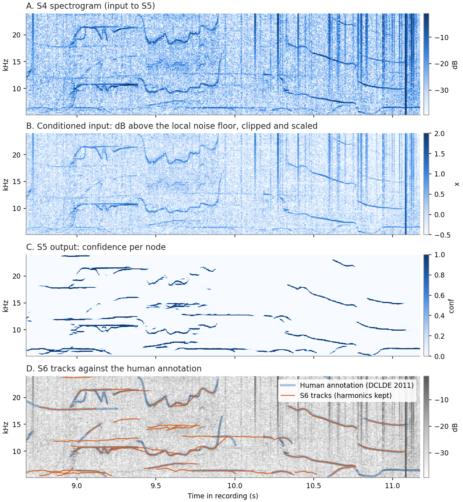
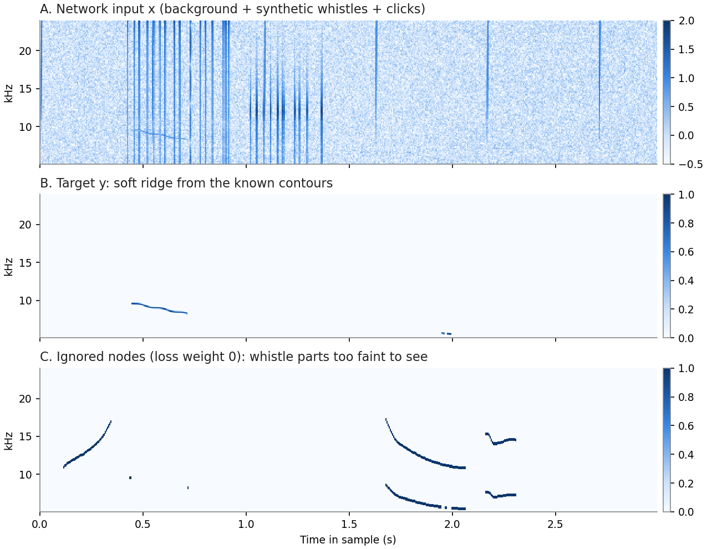

# The whistle detector: a complete study guide

**Detector name:** RidgeNet (stage S5) + the tracker (stage S6).
**Versions:** `ridgenet-v2c` (2–24 kHz, builds the VAE-GMM dataset) and `ridgenet-5-24` (5–24 kHz, DCLDE 2011 benchmark).

**About the numbers.** The worked examples were produced by running the project's real functions on small inputs and on a
real recording, unless marked *hand-picked illustration*. Results are copied from the saved result files or `mod_detector_5_24/TODO.md`.

---

## 1. The idea in one page

A dolphin whistle, drawn on a spectrogram, looks like **one thin line that moves over time**. The detector's job is to find those
lines and write each one down as a list of *(time, frequency)* points.

It works in two halves:

| Half | Stage | Question it answers | Output |
|---|---|---|---|
| **The eye** | S5, RidgeNet (a small neural network) | "How likely is it that *this exact pixel* lies on a whistle line?" | A confidence picture, same size as the spectrogram |
| **The hand** | S6, the tracker (ordinary rules, no learning) | "Which bright pixels join up into one whistle, and which groups should I throw away?" | A list of whistle tracks |

**Real-life picture.** Think of tracing faint pencil lines on a smudged page. First you squint and judge where the pencil marks
are (S5). Then you put your pen down and join the marks into separate strokes, ignoring specks and smudges (S6).

**The unusual part is how it was taught.** Nobody has hand-labelled whistles in our recordings. So we teach the network with
fake whistles drawn onto real ocean noise. Because we drew them ourselves, we know exactly where each one is.

```
                    USING THE DETECTOR (inference)
 audio → S1 pick channel → S2 resample to 192 kHz → S3 high-pass → S4 spectrogram
       → S5 conditioning → S5 RidgeNet → confidence map
       → S6 peaks → S6 linking → S6 filtering → whistle tracks

                    TEACHING THE DETECTOR (training, done once)
 real quiet ocean audio ─┐
 fake whistles ──────────┼→ mixed audio → same S4 → same conditioning → RidgeNet → prediction
 fake clicks and sweeps ─┘                                                            │
 known whistle positions → target y and weight w ─────────────────────→ loss ← ───────┘
                                                                          │
                                                       update the 14,209 weights, repeat 6,000 times
```

Below is the whole chain on a real recording. The rest of this guide explains how each panel turns into the next.



*Real clip: melon-headed whale recording `palmyra102006-061020-204327_4`, 8.68–11.17 s, `ridgenet-5-24`, harmonics kept. Panels A to D are S4,
the conditioned input, S5's confidence and S6's tracks.*

---

## 2. How we built it, and why it looks like this

1. **The problem.** The base paper (Park et al.) gets its whistles from a detector (its reference [31]) and tracker (refs [32], [33]) that
   are not available. S5 and S6 are therefore **newly designed replacements**. They are not a reproduction and are not claimed to be equivalent.
2. **The design constraint.** There is no ground truth for our recordings, so we could not train on real labels. Hence synthetic training.
3. **`ridgenet-v1`.** The first working version. Checking real output by eye found a pulse-train artefact (17 near-identical short tracks in
   one burst), so we added the *synchronous comb* rule to S6. We also found that a GPU speed setting (TF32) changed confidence enough to change the tracks,
   so it was turned off.
4. **Experiments (v2a to v2e).** Each was compared whistle by whistle against the same synthetic set, with S6 frozen.

   | Version | Change | Outcome |
   |---|---|---|
   | v2a | Wider network view | Worse (+15 / −32 whistles against v1, p = 0.019) |
   | v2b | Training data only: more faint whistles, crossings, time reversal | No effect (+14 / −13) |
   | **v2c** | v2b + **background-label fix** (section 7.5) | **Best: adopted** (test recall 0.704 → 0.729, 5–10 dB recall 0.519 → 0.647) |
   | v2d | v2c + wider view | No better than v2c, slower |
   | v2e | Label fix with v1's SNR balance | No better than v2c |

   Depthwise-separable blocks were also tried. They do fewer multiplications but ran *slower* in practice (GPU 1.3–1.7×, CPU 4–6×), so
   the network stayed with ordinary "dense" blocks.
5. **`ridgenet-5-24`.** The public DCLDE 2011 benchmark labels whistles from 5 kHz upward, so we retrained the same design with its band starting at
   5 kHz. It lives in `mod_detector_5_24/`, is used for the benchmark only, and leaves the main pipeline untouched.

### Where the two versions differ

| Setting | `ridgenet-v2c` | `ridgenet-5-24` |
|---|---|---|
| Band | 2–24 kHz, bins 22–256 (235 bins) | 5–24 kHz, bins 54–256 (203 bins) |
| Synthetic whistle range | 2,300–23,700 Hz | 5,300–23,700 Hz |
| S6 threshold `peak_threshold` | 0.5 | 0.4 |
| Background banks | Its own | Rebuilt in the new band (may keep different windows) |
| Everything else | Same | Same (network, seed, conditioning, 6,000 steps) |

All examples below use `ridgenet-5-24`.

---

## 3. Words you need first

**Spectrogram.** A picture of sound. Left to right is time, bottom to top is pitch, and darkness is loudness. It is like sheet music where
the ink gets darker as the note gets louder.

**Node.** One pixel of the spectrogram, identified as (frame *t*, bin *k*). "Node" and "pixel" mean the same thing in this guide.

**Bin.** One row of pitch. Here, 1 bin = **93.75 Hz**, and bin *k* means frequency *k* × 93.75 Hz. So bin 107 = 10,031.25 Hz.

**Frame.** One column of time. Here, 1 frame = **5.333 ms**. So 12 frames ≈ 64 ms, and 188 frames ≈ 1 s.

**dB (decibels).** A loudness scale where adding numbers means multiplying power. "+6 dB" is about twice the amplitude and "+20 dB" is ten times.
Only differences are meaningful in our recordings, because the levels are uncalibrated.

**SNR.** Signal-to-noise ratio: how many dB a whistle stands above the background. 0 dB is level with the noise, and 20 dB is obvious.

**What things look like.**

| Sound | Shape on the spectrogram | Panel A above |
|---|---|---|
| Whistle | Thin line, 1–3 bins tall, 20–100+ frames long | The curving dark lines |
| Harmonic | A copy of a whistle at 2×, 3× its pitch, usually fainter | The 10 kHz line and its copy near 20 kHz |
| Click | Tall vertical streak, 1–3 frames wide | The vertical stripes near 11 s |
| Background noise | Grainy texture | Everything else |

This table is the root of the whole design: **the network must prefer long thin horizontal things and reject tall thin vertical things.**

---

## 4. Preparing the sound (S1 to S4)

These stages come from the paper or are recorded implementation decisions. They are shared with training, which matters: the network must see
training and real data made in exactly the same way.

### S1: pick one channel (`audio.py`)
Our files have 6 hydrophones. We use channel 0 and scale the 16-bit integers to the range −1 to 1. Example: sample value 16384 → 16384 / 32768 = 0.5.
Channel 0 is an arbitrary choice. The DCLDE recordings are already single channel.

### S2: resample to 192 kHz (`dsp.py`)
| Parameter | Value | Meaning |
|---|---|---|
| `fs_target_hz` | 192,000 | Paper value |
| `method` | `resample_poly` | Polyphase filter |
| Ratio | 48/125 | 500,000 × 48 / 125 = 192,000 |
| `kaiser_beta` | 5.0 | Filter shape (scipy default) |

One second of 500 kHz audio (500,000 samples) becomes 192,000 samples. DCLDE audio is already at 192 kHz, so nothing happens to it.

### S3: remove low rumble (`dsp.py`)
A 4th-order Butterworth high-pass at 2 kHz, run forward and backward (`zero_phase = true`), so whistle timing is not shifted. Running it twice gives −6 dB at 2 kHz.
*Real life:* like the rumble filter on a mixing desk. It removes ship and sea noise and leaves whistles.

This stays at 2 kHz even in the 5–24 kHz version, because the paper's values are locked. The 5 kHz edge comes from the band S5 looks at.

### S4: make the spectrogram (`dsp.stft_db`)
| Parameter | Value | What it does |
|---|---|---|
| `win_len` | 2048 samples (10.67 ms) | Length of each slice of sound |
| `hop` | 1024 samples (5.33 ms) | Step between slices (50 % overlap) |
| `nfft` | 2048 | Gives 1025 bins, 93.75 Hz apart |
| window | Periodic Hamming | Softens slice edges to reduce spectral smearing |
| `eps` | 1e-12 | Avoids log(0) |

**Steps:**
1. Cut a 2048-sample slice at sample `t × 1024`.
2. Multiply it by the Hamming window.
3. Run an FFT, which measures how much of each pitch is present.
4. Convert to dB: `20 × log10(|X| + eps)`.

**Number of frames:** `T = (N − 2048) // 1024 + 1`. A 60 s file has N = 11,520,000, so T = **11,249**.

**Worked example (real run).** A pure 10,000 Hz tone with amplitude 1:

| Step | Result |
|---|---|
| 10,000 / 93.75 | 106.67, between bins 106 and 107 |
| Strongest bin | 107 (10,031.25 Hz) at 54.1 dB |
| Nearby bins 104–109 (dB) | −7.9, 29.7, 51.7, **54.1**, 40.7, 8.8 |

So one pure tone lights up about 3 bins strongly. That is why a whistle looks 1–3 bins tall, and why targets later use a soft ridge rather than a single pixel.
Tone energy also follows a formula: amplitude A gives peak magnitude `A × 552.96` (half the window's sum), so A = 1 at the exact centre of a bin gives 54.85 dB. The synthetic generator uses this
to set a whistle's loudness precisely.

**Output shape:** `(T, 1025)`. S5 only keeps its band, so `ridgenet-5-24` uses bins 54–256 = **203 bins** (5,062.5–24,000 Hz).

---

## 5. Stage S5, part 1: conditioning (`detector/conditioning.py`)

**The problem.** A recording made close to the animal may be 30 dB louder than another. The network should not care about absolute level. It should only ask: *does this stand out from what's around it?*

**Real life.** At a quiet library, a normal voice stands out. At a loud concert, the same voice vanishes. You judge a sound against its surroundings.
Conditioning subtracts "the room's noise" separately for each pitch.

### Parameters
| Parameter | Value | Meaning |
|---|---|---|
| `block_frames` | 64 (0.34 s) | Time blocks used for the first median |
| `median_blocks` | 7 (about 2.4 s) | Number of blocks smoothed over |
| `clip_lo_db` / `clip_hi_db` | −10 / +40 | Limits on dB above the floor |
| `scale_db` | 20 | Divide by this so values are around 1 |

### Steps
For each frequency bin separately:
1. Cut time into blocks of 64 frames and take the **median** of each block.
2. Take a running median over 7 neighbouring blocks.
3. Interpolate back to one floor value per frame.
4. Compute `x = clip(dB − floor, −10, +40) / 20`.

### Why median and not average?
A whistle is rare and loud, so it should not raise the estimate of the noise. Five dB values with one whistle: −80, −81, −79, **−50**, −80.

| Method | Result |
|---|---|
| Average | −74 (dragged up 6 dB by the whistle) |
| Median | −80 (ignores it) |

### Worked examples (real run)
Tiny case with a floor at −80 dB:

| Node | dB | dB − floor | After clip | x |
|---|---|---|---|---|
| Plain noise | −80 | 0 | 0 | **0.0** |
| Whistle | −50 | +30 | +30 | **1.5** |
| Very loud click | −30 | +50 | +40 | **2.0** |
| Dropout | −95 | −15 | −10 | **−0.5** |

Real node, recording above, frame 1877, around 12.7 kHz:

| Bin | 134 | 135 | **136** | 137 | 138 |
|---|---|---|---|---|---|
| S4 dB | −21.5 | −15.4 | **−14.9** | −21.2 | −22.8 |
| Floor dB | −26.1 | −26.0 | **−27.5** | −27.4 | −28.1 |
| x | 0.23 | 0.53 | **0.63** | 0.31 | 0.27 |

Check bin 136: (−14.9 − (−27.5)) / 20 = 12.6 / 20 = **0.63**.

This is internal to S5. The S4 output itself is never changed, and training and inference call this same function.

---

## 6. Stage S5, part 2: RidgeNet (`detector/ridgenet.py`)

### 6.1 The structure

```
Input x         (1 × T × 203)      1 value per node
  │
  ├─ Stem:      3×3 conv → BatchNorm → ReLU                       (16 × T × 203)
  ├─ Block 1:   3×3 conv, dilation (time 1, freq 1) → BN → ReLU, + skip
  ├─ Block 2:   dilation (2, 1)
  ├─ Block 3:   dilation (4, 2)
  ├─ Block 4:   dilation (8, 2)
  ├─ Block 5:   dilation (1, 1)
  ├─ Block 6:   dilation (2, 1)                                   (16 × T × 203)
  ├─ Head:      1×1 conv                                          (1 × T × 203)
  └─ Sigmoid                                                       values 0 to 1
Output          (T × 203)          1 confidence per node
```

The width and height never change, since there is no pooling. That keeps the output aligned pixel for pixel with the spectrogram.

### 6.2 Every part

**Convolution: a small stencil slid over the image.** A 3×3 convolution looks at a pixel and its 8 neighbours, multiplies them by 9 learned numbers, and adds them up. Each of the 16 **channels** is its own
stencil, and each learns a different pattern, such as "a slightly rising line" or "a tall streak".

*Real life:* a set of 16 rubber stamps. Each lights up when the picture beneath it matches its shape.

**Dilation: spaced-out stencil.** Same 9 numbers, but the points are spread apart. With dilation (time 8, freq 2) the stencil at (t, k) looks at:

```
 time →      t−8      t      t+8
 k+2          ●       ●       ●
 k            ●       ●       ●
 k−2          ●       ●       ●
```
It sees far along time without needing more weights.

*Real life:* to check a road is straight, you look at spots far apart. You do not inspect every metre.

The dilations favour time (up to 8) over frequency (up to 2) on purpose. A whistle is long and thin, so the useful context runs along time.

**BatchNorm: keep the numbers in a healthy range.** It rescales each channel using a mean and spread, with 2 learned values per channel. During training this uses the batch; at inference, stored averages.

**ReLU: the on/off decision.** `ReLU(v) = max(0, v)`, so −3 → 0 and 2 → 2. Without it, stacked layers would collapse into one single linear operation.

**Skip connection.** `h = h + block(h)`. Each block only has to learn a *correction* to what already exists. This makes training much easier.
*Real life:* editing a draft instead of rewriting the essay from scratch at each pass.

**Head: combine 16 opinions into one.** A 1×1 convolution: a weighted sum of the 16 channels plus a bias. The result is a **logit**, any number.

**Sigmoid: logit → confidence.** `p = 1 / (1 + e^(−logit))`.

| Logit | −4 | −2 | 0 | 2 | 4 |
|---|---|---|---|---|---|
| Confidence | 0.018 | 0.119 | 0.5 | 0.881 | 0.982 |

### 6.3 Parameters: 14,209 weights, counted

| Layer | Calculation | Weights |
|---|---|---|
| Stem conv | 1 input × 16 outputs × 9 (no bias) | 144 |
| Stem BatchNorm | 16 × 2 | 32 |
| Each block conv | 16 × 16 × 9 | 2,304 |
| Each block BatchNorm | 16 × 2 | 32 |
| Six blocks | 6 × (2,304 + 32) | 14,016 |
| Head | 16 + 1 bias | 17 |
| **Total** | 144 + 32 + 14,016 + 17 | **14,209** |

This matches the saved `train_info.json`. It is tiny: VGG-16, a well-known image model, has about 138 million. Cost is **13,984 multiplications per node** (`macs_per_node`).

### 6.4 Receptive field: how much it can see

The output at one node depends only on inputs inside a window. Each layer adds `2 × dilation`:

| After | Time dilation | Frequency dilation | Window (frames × bins) |
|---|---|---|---|
| Stem | 1 | 1 | 3 × 3 |
| Block 1 | 1 | 1 | 5 × 5 |
| Block 2 | 2 | 1 | 9 × 7 |
| Block 3 | 4 | 2 | 17 × 11 |
| Block 4 | 8 | 2 | 33 × 15 |
| Block 5 | 1 | 1 | 35 × 17 |
| Block 6 | 2 | 1 | **39 × 19** |

So it sees **±19 frames (208 ms total) × ±9 bins (1.8 kHz total)**. I checked this by experiment: changing a single input pixel changed outputs exactly from −19 to +19 frames and −9 to +9 bins.

*Real life:* looking through a letterbox slot a fifth of a second wide and 1.8 kHz tall. That's long enough to see a line continuing, and a click looks like a short stub crossing it.

### 6.5 What the network adds beyond contrast

From the real node in section 5:

| Bin | 132 | 133 | 134 | 135 | **136** | 137 | 138 | 139 | 140 |
|---|---|---|---|---|---|---|---|---|---|
| x (input) | 0.17 | −0.09 | 0.23 | 0.53 | **0.63** | 0.31 | 0.27 | 0.02 | 0.09 |
| conf (output) | 0.000 | 0.000 | 0.000 | 0.984 | **0.999** | 0.102 | 0.000 | 0.000 | 0.000 |

Bins 134 and 137 stand out by similar amounts in *x* (0.23, 0.31), yet confidence at 134 is 0 and at 137 only 0.10. Just looking at brightness at a single point couldn't separate these.
The network uses the 39 × 19 window to decide that only bins 135–136 lie on the line. That is visible in the figure too: panel B is grainy, while panel C is nearly clean.

### 6.6 Running it on long files

| Parameter | Value | Why |
|---|---|---|
| `tile_frames` | 2048 | Split long files into tiles to save memory |
| `halo_frames` | 32 | Extra context on each side; must be ≥ 19 (code checks) |

Example, 12,223 frames: the first tile outputs frames 0–2047 from input 0–2079. The second outputs 2048–4095 from input 2016–4127. Because the halo exceeds the 19-frame radius, the output is identical with or without tiling (a test verifies this).

**S5's output** (`DetectionMap`) has shape `(T, F)`, with values in 0–1. S5 does **no thresholding**. Deciding what counts as a whistle is left to S6.

---

## 7. How RidgeNet was taught

Sections 7.1–7.6 happen only during training. None of it runs when the detector is used.

### 7.1 Real backgrounds (`synth/backgrounds.py`)

**Why real noise?** Real ocean noise is messy, with boats, snapping shrimp and hydrophone quirks, and no formula imitates it well.

**Why screen it?** Real whistles left in a background would be labelled "not a whistle" and teach the wrong thing.

| Parameter | Value | Meaning |
|---|---|---|
| `n_files` | train 24, val 16, test 16 | 56 files from encounter 191; no file shared between splits or with the validation sets |
| `windows_per_file` | train 20, val 12, test 12 | Kept per file, at most |
| `window_s` | 3.0 | Length of each window |
| `candidates_per_file` | 60 | **Not read by the code.** It actually tries one start per second, about 57 for a 60 s file |
| `screen_db` | 8.0 | "Tonal" means this far above the floor... |
| `screen_persist`, `screen_fraction` | 9, 0.7 | ...for ≥ 70 % of a 9-frame span... |
| `screen_guard_bins` | [3, 5] | ...with neighbours 3–5 bins away *not* tonal (so it's narrow) |
| `screen_max_score` | 0.02 | Keep only windows scoring at or below this |
| `p_time_reverse` | 0.5 | Half of training windows are played backward |

**Ridge score** = the fraction of frames holding a narrow, persistent ridge.

**Steps:** score a window every second → sort by score → take the lowest, keeping windows at most 50 % overlapping → stop at the cap or the limit.

**Worked example (real run).** Pure noise scores 0.0. A 0.3 s, 15 dB ridge in a 3 s window scores as follows:

| Sweep rate | 0 Hz/s (flat) | 879 | 1,758 | 2,637 | 3,516 and faster |
|---|---|---|---|---|---|
| Score | 0.093 | 0.078 | 0.050 | 0.032 | **0.000** |

The flat result matches the config comment ("a single 0.3 s whistle scores ~0.10"). The last column shows a real weakness: **the screen misses whistles sweeping faster than about 3.5 kHz/s**, because they don't stay in one bin long enough. This is one reason the label fix in 7.5 was needed.

### 7.2 Fake whistles (`synth/whistles.py`)

| Parameter | Value | Meaning |
|---|---|---|
| `p_n_whistles` | 0.10, 0.25, 0.25, 0.18, 0.12, 0.10 | Chance of 0, 1, 2, 3, 4, 5 whistles per window (average 2.27) |
| `p_scenario` | random 0.6, crossing 0.2, parallel 0.2 | How the second whistle relates to the first |
| `duration_s` | 0.10–1.00, log-uniform | Median about 0.32 s |
| `f_range_hz` | 5,300–23,700 | Allowed pitch range |
| `slope_max_hz_per_s` | 60,000 | Fastest allowed sweep |
| `n_knots` | 2–6 | Number of control points |
| `p_ripple`, `ripple_rate_hz`, `ripple_depth_hz` | 0.3, 5–20, 30–250 | Optional wobble |
| `snr_mix` | 25 %: −2 to 4 dB; 50 %: 4 to 12; 25 %: 12 to 24 | Mostly faint or moderate on purpose |
| `p_harmonic2`, `p_harmonic3` | 0.6, 0.3 | Chance of adding harmonics |
| `harmonic_rel_db` | −15 to −3 | Harmonic level (3rd is a further 5 dB lower) |
| `parallel_offset_bins` | 2–4 | Gap for parallel pairs |

Shape styles: up 25 %, wavy 25 %, down 20 %, arch 15 %, valley 10 %, flat 5 %.

**Step-by-step, one whistle** (*hand-picked illustration*; the formulas are the code's):
1. **Duration:** 0.5 s, so 96,000 samples.
2. **Style and knots:** "up" with 3 knots.
3. **Pitch points:** start 8,000 Hz; add positive jumps 700 and 300 → 8,000, 8,700, 9,000 Hz at times 0, 0.2, 0.5 s.
4. **Smooth curve:** PCHIP interpolation gives one frequency per sample without overshoot.
5. **Limits:** if too steep, compress about the mean. If outside the range, compress or shift it back in.
6. **Loudness:** draw SNR = 12 dB. If background magnitude at this pitch is `L = 0.002`, then `amp = 10^(12/20) × 0.002 / 552.96 = 1.44e-5`. Its peak spectrogram magnitude is then 1.44e-5 × 552.96 = 0.00796, exactly 12 dB above L.
7. **Fade in and out:** Tukey window plus slight amplitude wobble.
8. **Make the waveform:** `phase = 2π × cumsum(f) / fs`, then `sin(phase)`. At 10 kHz, phase advances 18.75° per sample. Using running phase keeps the wave smooth as pitch changes.
9. **Harmonics:** with 60 % chance add `sin(2 × phase)`; for example, at −8 dB relative.

**Scenarios:**
- *Crossing:* mirror the first whistle about its mean pitch, so they make an X. Teaches the network not to break at intersections.
- *Parallel:* the same shape 2–4 bins away. Teaches it to keep close neighbours apart.

### 7.3 Fake clicks and sweeps: the distractors

They are never labelled as positives, so the network learns to ignore them.

| Parameter | Value | Meaning |
|---|---|---|
| `p_click_train`, `n_trains`, `n_clicks` | 0.6, 1–3, 3–25 | How many |
| `ici_ms` | 10–80 | Time between clicks |
| `center_khz`, `decay_ms` | 8–70, 0.05–0.30 | Pitch and length of a pulse |
| `level_db` | 10–35 | Above the window's RMS |
| `p_sweep_train` | 0.2 | Repeating broadband sweeps, imitating echosounders |

The input panel of the figure below shows both kinds. The clicks are loud but carry no target, so the network is punished for reacting to them.

### 7.4 Answer key: target y and weight w (`_labels`)

| Parameter | Value | Meaning |
|---|---|---|
| `sigma_bins` | 0.8 | Width of the soft ridge |
| `snr_pos_db` | 3.0 | Below this, a part of a whistle counts as invisible |
| `ignore_radius_bins` | 2 | Ignore this far around an invisible part |
| `min_envelope` | 0.05 | Skip the very quiet fade edges |

**Why a soft ridge?** True pitch usually falls between bins, and energy spreads over about 3 bins (section 4). A hard yes/no on a single pixel would be wrong.

**Worked example.** At some frame the whistle is at 10,000 Hz: 10,000 / 93.75 − 54 = **position 52.67** in the band. Then `y = exp(−0.5 × (distance / 0.8)²)`:

| Band position | 51 | 52 | 53 | 54 | 55 |
|---|---|---|---|---|---|
| Distance | 1.67 | 0.67 | 0.33 | 1.33 | 2.33 |
| y | 0.113 | 0.704 | **0.918** | 0.251 | 0.014 |

**Why a weight?** The rule is "**don't punish the network for what can't be seen**":
- Whistle part with SNR ≥ 3 dB → y is the ridge, weight 1. It must be found.
- Whistle part with SNR < 3 dB → weight 0 within ±2 bins. It is neither right nor wrong to detect.
- Everything else → y = 0, weight 1. It must stay dark.

*Real life:* a teacher doesn't mark a question that got smudged off the photocopy.



*One sample from the real generator, illustrative only: the background here is a phase-randomised DCLDE window, not the encounter-191 bank used in training. Of its 4 whistles (SNR 19.1, −0.4, 0.6, 1.6 dB), only the
loud one and a short strip of another are targets. The faint ones are in the ignore panel. Clicks appear in A with no target in B.*

### 7.5 The background-label fix: the v2c improvement

**The problem.** Screening is imperfect. Faint real whistles stay in the backgrounds, and without the fix they're labelled "not a whistle". The network is literally being taught to ignore faint whistles.

**The fix.** Find probable real ridges with a classical method using no labels, then give those nodes **weight 0**.

| Parameter | Value | Meaning |
|---|---|---|
| `ignore_background_ridges` | true | Turn on |
| `bg_ridge_len` | 25 | Line length in frames |
| `bg_ridge_slopes` | 13 slopes, −1 to +1 bins/frame | Line angles to try |
| `bg_ridge_db` | 4.0 | Median dB above floor needed |
| `bg_ridge_dilate` | [1, 3] | Widen the mask slightly in frequency |

**Steps, for each node:**
1. Lay a 25-frame "ruler" through it at each of the 13 slopes.
2. For each, take the **median** dB-above-floor along the ruler.
3. Take the largest median over all slopes.
4. If above 4 dB, mark it.

**Why it works.** A median along a line is high only if most of the line is bright. Clicks cover 1–3 of 25 frames and noise is random, so neither scores high.

**Worked example (real run).** Noise image plus a 10 dB ridge rising 0.3 bins/frame:

| Node | Statistic | Marked? |
|---|---|---|
| On the ridge | 6.07 dB | Yes |
| Away from it | 1.07 dB | No |

With no ridge, 0 % of nodes were marked.

*Real life:* to tell if a faint scratch on a photo is real, lay a ruler along it and check whether the darkness continues. Dust specks don't continue.

**Measured on real backgrounds:** it marks 2.19 % of nodes, against 0.65 % of phase-randomised noise, so about 70 % of what it marks is real structure. Isolated effect, v2c vs v2b: **+24 / −11 whistles, p = 0.041**.

### 7.6 The loss: how wrongness is measured (`train.py`)

`Loss = weighted BCE + dice_weight × Dice`

| Parameter | Value | Meaning |
|---|---|---|
| `pos_weight` | 6.0 | Whistle nodes (y > 0.1) count 6× |
| `dice_weight` | 1.0 | Equal share for Dice |

**Why two parts?**
- **BCE** judges each node separately. On its own there's a trap: in the sample above only about 0.18 % of nodes are whistle, so answering "no whistle anywhere" would look nearly perfect. Hence `pos_weight`.
- **Dice** measures overlap between predicted and true shapes. It ignores the sea of empty background.

**Worked example (real run)** with 4 nodes: y = [1, 0.46, 0, 0], w = [1, 1, 1, **0**].

| Prediction p | Situation | BCE | Dice | **Total** |
|---|---|---|---|---|
| [0.9, 0.5, 0.05, 0.9] | Good | 1.614 | 0.166 | **1.780** |
| [0.1, 0.1, 0.05, 0.9] | Missed the whistle | 6.854 | 0.523 | **7.378** |
| [0.9, 0.5, 0.9, 0.9] | False alarm at node 3 | 2.365 | 0.315 | **2.680** |
| [0.9, 0.5, 0.05, **0.01**] | Only the ignored node changed | 1.614 | 0.166 | **1.780** |

The hand calculation for the "good" row:

```
Node 1: −ln(0.9) = 0.105, × 6 (whistle)               = 0.632
Node 2: y=0.46, p=0.5: 0.693, × 6 (whistle)           = 4.159
Node 3: −ln(0.95) = 0.051, × 1                        = 0.051
Node 4: weight 0                                      = 0
BCE  = 4.842 / (sum of w = 3)                         = 1.614

overlap = 0.9×1 + 0.5×0.46                            = 1.13
Dice = 1 − (2×1.13 + 1) / (1.45 + 1.46 + 1)           = 0.166
```

What this shows:
- Missing a whistle costs far more than a false alarm, which favours recall by design. It's also a likely contributor to the precision weakness in section 9, though I haven't tested that.
- The last row equals the first: the ignored node really has no effect.
- The good row isn't 0, because a soft target such as 0.46 can't reach zero BCE.

### 7.7 The training loop

| Parameter | Value | Meaning |
|---|---|---|
| `steps`, `batch_size` | 6,000, 16 | 96,000 patches, each freshly generated |
| `crop_frames` | 256 (1.37 s) | Random crop from the 3 s sample |
| `lr` | 0.003 peak | Learning rate; OneCycle, rising for the first 10 %, then falling |
| `weight_decay` | 0.0001 | Keeps weights small (AdamW) |
| `val_every`, `val_samples` | 500, 600 | Check against a fixed validation set |
| `seed` | 20261008 | Makes the data stream reproducible |

**One step:**
1. Generate 16 patches: background + whistles + clicks → STFT → conditioning.
2. Run the network, compute loss.
3. Backpropagate: find how each of the 14,209 weights affects the loss.
4. Update the weights with AdamW.
5. Every 500 steps, score validation and **save only if node F1 is the best so far**.

**Actual run (`ridgenet-5-24`), Colab Tesla T4, 6,070 s (about 101 min):**

| Step | 500 | 1000 | 1500 | **2000** | 2500 | 3000 | 4000 | 5000 | 6000 |
|---|---|---|---|---|---|---|---|---|---|
| Node precision | 0.484 | 0.520 | 0.443 | **0.518** | 0.499 | 0.437 | 0.443 | 0.464 | 0.449 |
| Node recall | 0.617 | 0.596 | 0.669 | **0.609** | 0.620 | 0.707 | 0.712 | 0.682 | 0.701 |
| Node F1 | 0.542 | 0.555 | 0.533 | **0.559** | 0.553 | 0.540 | 0.546 | 0.552 | 0.548 |

**The saved checkpoint comes from step 2000**, not 6000. F1 barely moves after step 500 (0.533–0.559), so the choice between these steps is close to noise.

---

## 8. Stage S6: the tracker (`tracking.py`)

Confidence maps are still only pixels. S6 turns them into separate whistles, in three steps. It uses rules, not learning.

### 8.1 Step 1: find peaks in each frame

| Parameter | Value | Meaning |
|---|---|---|
| `peak_threshold` (τ) | 0.4 (v2c: 0.5) | Minimum confidence |
| `broadband_frame_fraction` | 0.30 | Skip the frame if more than this share of nodes is above τ |
| `min_peak_separation_bins` | 2 | Closer peaks merge (187.5 Hz) |

**Steps, per frame:**
1. Mark local maxima along frequency that are ≥ τ.
2. If more than 30 % of the band is above τ (more than 60 of 203 nodes), treat the frame as a click and drop it.
3. Refine to a fraction of a bin: `k' = k + (right − left) / (left + centre + right)`.
4. If two peaks are under 2 bins apart, keep the stronger.

**Worked example (real run).** One frame, τ = 0.4:

```
bin:   0    1    2    3    4    5    6     7    8    9
conf: 0.1  0.2  0.7 [0.9] 0.6  0.1  0.05  0.3 [0.5] 0.2     (remaining bins 0)
```
- Peak at bin 3: 3 + (0.6 − 0.7) / (0.7 + 0.9 + 0.6) = **2.955**
- Peak at bin 8: 8 + (0.2 − 0.3) / (0.3 + 0.5 + 0.2) = **7.900**

**Too close:** conf = 0.1, **0.8**, 0.3, **0.6**, 0.1 gives peaks at 1.167 and 2.800, which are 1.63 bins apart. They merge and only the stronger, 1.167, survives.

**On the real node:** band index 82 is bin 136, with neighbours 0.984 and 0.102:
`136 + (0.102 − 0.984) / (0.984 + 0.999 + 0.102) = 135.577`, and × 93.75 = **12,710.3 Hz**. That's exactly the frequency on the real track.

### 8.2 Step 2: link peaks over time

*Real life:* air-traffic radar. Each sweep shows blips. The controller predicts where each plane should be, matches blips to planes, and keeps following a plane briefly if it disappears behind a cloud.

| Parameter | Value | Meaning |
|---|---|---|
| `predict_points` | 5 | Fit a line through the last 5 points |
| `gate_base_bins` | 3.0 | Search radius (±281 Hz) |
| `gate_growth_per_miss` | 0.5 | Widens per missed frame |
| `gate_max_bins` | 8.0 | Limit (±750 Hz) |
| `max_gap_frames` | 12 | Give up after this many misses (64 ms) |

**Steps, per frame:**
1. **Predict** each active track's next bin with a straight line.
2. **Gate:** `gate = min(8, 3 + 0.5 × misses)`. For 0, 1, 2, 4, 10 misses: 3, 3.5, 4, 5, 8.
3. **Cost** per track and peak: `distance / gate + 0.3 × (1 − confidence)`. Impossible if outside the gate.
4. **Assign** using the Hungarian algorithm, which finds the lowest *total* cost.
   *Real life:* giving taxis to passengers to minimise total distance. The closest pair isn't always matched, because that may leave someone else stranded.
5. **Unmatched track:** misses + 1. Over 12, it closes. This is "coasting".
6. **Unmatched peak:** starts a new track.

**Worked example (real run).** A whistle rising 2 bins per frame, missing for 2 frames, plus a separate tone at bin 150 appearing in frames 7–8.

| Frame | 0 | 1 | 2 | 3 | 4 | 5 | 6 | 7 | 8 | 9 |
|---|---|---|---|---|---|---|---|---|---|---|
| Peaks | 100 | 102 | 104 | 106 | 108 | none | none | 114.2, 150 | 116.1, 150 | 118 |

At frame 7:
- The line through 100…108 predicts **114.0**.
- There have been 2 misses, so gate = 3 + 0.5 × 2 = **4 bins**.
- Peak 114.2: distance 0.2, inside the gate. With confidence 0.8, cost = 0.2/4 + 0.3 × 0.2 = **0.11**.
- Peak 150: distance 36, outside. So it starts a new track.

Result from the code:
```
Track 0: frames 0,1,2,3,4,7,8,9   bins 100,102,104,106,108,114.2,116.1,118
Track 1: frames 7,8               bins 150,150
```
Later, S6 fills frames 5 and 6 by interpolation and marks them as *not observed*.

**Crossing test (real run).** One whistle rising 100→130, another falling 130→100, crossing in the middle. Output: both stay correct:
```
Track 0: 100, 102, 104, ... 126, 128, 130
Track 1: 130, 128, 126, ... 104, 102, 100
```
The straight-line prediction carries each through the X.

Tracks with just one peak are dropped immediately.

### 8.3 Step 3: filter out bad tracks

| Rule | Parameters | Rejects | Why |
|---|---|---|---|
| `too_short` | `min_track_frames` = 12 (64 ms) | Span under 12 frames | Likely noise specks |
| `low_observed_fraction` | `min_observed_fraction` = 0.5 | Under 50 % real peaks | Mostly guessed |
| `low_confidence` | `min_mean_conf` = 0.55 | Mean confidence under 0.55 | Network wasn't sure |
| `too_steep` | `max_mean_slope_bins_per_frame` = 3 (52.7 kHz/s) | Too fast on average | Not a plausible whistle |
| `duplicate` | `duplicate_tol_bins` = 1.5, `duplicate_min_overlap` = 0.8 | Same path as a stronger track | Same whistle found twice |
| `synchronous_comb` | `comb_min_tracks` = 6, start and span tolerance 3 frames | 6+ tracks starting together with equal length | Pulse-train lattice |
| `harmonic` | `harmonic_orders` = 2, 3, 4; `harmonic_rel_tol` = 0.03; `harmonic_min_overlap` = 0.7 | Pitch is 2×, 3× or 4× a lower track | Keep fundamentals only |

**Worked example (real run).** Seven tracks into the real filter:

| Track | Description | Result |
|---|---|---|
| 0 | 40 frames, rising, confidence 0.8 | **Kept** |
| 1 | 8 frames | `too_short` |
| 2 | Only 1 in 3 frames observed | `low_observed_fraction` (0.33) |
| 3 | Confidence 0.50 | `low_confidence` |
| 4 | Rising 4 bins/frame | `too_steep` |
| 5 | Same as track 0 but 0.8 bins higher, confidence 0.6 | `duplicate` of 0 |
| 6 | Exactly 2× track 0's pitch | `harmonic` of 0 |

Also: seven tracks starting within a frame, with 14–15 frame lengths, were all rejected as `synchronous_comb`.

**Harmonic check:** track at 8,000 Hz and one at 16,000 Hz gives a ratio of 2.00. With 3 % tolerance, 1.94–2.06 counts. At least 70 % of the upper track must overlap the lower in time, and at least 80 % of overlapping frames must fit the ratio.

**The switch:** the VAE-GMM dataset wants fundamentals, so suppression is on. DCLDE annotations include harmonics, so the benchmark runs with `decisions.s6.suppress_harmonics=false`.

### 8.4 Output

Each track has `frames`, `freq_hz` (one value per frame), `conf` and `observed`. Every rejection is kept with its reason.

---

## 9. Choosing τ and measuring performance

### 9.1 Calibration of τ (`eval-synth --calibrate`)
Rule: over τ = 0.30, 0.35, … 0.80, keep those with ≤ 2 false tracks/min on clean negatives, keep those within 0.01 of the best recall, then choose the one nearest 0.5.

| τ | 0.30 | 0.35 | **0.40** | 0.45 | 0.50 |
|---|---|---|---|---|---|
| Validation recall | 0.651 | 0.647 | **0.642** | 0.637 | 0.632 |

Best is 0.651, so the cutoff is 0.641. That leaves 0.30, 0.35, 0.40, and 0.40 is nearest 0.5. The curve is nearly flat (spread 0.04 over the grid), so the exact value matters little. Only synthetic validation was used, never real scores.

**Clean negatives** are backgrounds with phase randomised: same sound spectrum, but no whistle can survive. They give a false-alarm rate unaffected by leftover real whistles.

### 9.2 Synthetic test (`ridgenet-5-24`, τ = 0.4, run once)

A whistle counts as found if one track covers ≥ 60 % of its visible frames within 1.5 bins (140.6 Hz).

| Metric | Value |
|---|---|
| Node average precision | 0.553 (validation: 0.400) |
| Track recall | 0.629 (338 of 537) |
| Track precision | 0.576 (a *lower bound*: leftover real whistles count as false) |
| False tracks on clean negatives | **0.0/min** over 4.55 min |

| Whistle SNR | < 5 dB | 5–10 dB | 10–15 dB | ≥ 15 dB |
|---|---|---|---|---|
| Recall | 0.09 | 0.63 | 0.89 | 0.98 |

So it is reliable above 10 dB, and nearly blind under 5 dB.

### 9.3 Real benchmark: DCLDE 2011 (`mod_detector_5_24/dclde2011.py`)
12 recordings (43.2 min, 6,011 marked whistles) and 4 species, using the Li et al. (2023) protocol, re-implemented from Silbido's scoring code. The detector never saw this data in training.

**Rules:**
- **Whistle must be found (expected):** ≥ 150 ms, > 10 dB SNR over ≥ ⅓ of it, and entirely inside 5–24 kHz.
- **Match:** mean frequency difference ≤ 350 Hz, and the detection covers > 30 % of the whistle.
- **Precision** = detections matching expected whistles / (those + detections matching nothing). Detections matching only non-expected whistles count neither way.
- **Recall** = expected whistles matched / expected whistles.
- Pool per species, then average over the 4 species.

**Worked example (real run).** Three annotated whistles, each 0.49 s, all expected; four detections:

| Detection | Situation | Result |
|---|---|---|
| A | Along whistle 1, 100 Hz off | **Match** (100 ≤ 350) |
| B | First 0.09 s of whistle 2 | No: covers 18 %, needs > 30 % |
| C | Where no whistle exists | False positive |
| D | Along whistle 3, 800 Hz off | No: 800 > 350 |

Precision = 1/(1+3) = **25 %**. Recall = 1/3 = **33.3 %**. F1 = 2 × 25 × 33.3 / (25 + 33.3) = **28.6 %**.

**Results** (final run, 12 recordings, harmonics kept, detections ≥ 150 ms, 2011 annotations, species average;
files in `results/dclde2011_detections/`):

| Scoring | Silbido P / R / F1 | RidgeNet 5-24 P / R / F1 |
|---|---|---|
| **5–24 kHz, no 30 % rule (recommended main)** | **76.4 / 72.9 / 74.6** | **56.3 / 86.9 / 67.1** |
| 5–24 kHz, with 30 % rule | 64.5 / 70.0 / 67.1 | 47.1 / 85.2 / 59.9 |
| All frequencies, no 30 % rule | 71.4 / 72.4 / 71.6 | 57.6 / 76.6 / 63.8 |
| All frequencies, with 30 % rule | 61.3 / 69.8 / 65.1 | 48.5 / 74.5 / 57.3 |
| *Context only:* Li et al. 2023 best (5–50 kHz) | | 88.78 / 85.78 / 87.20 |

Other RidgeNet 5-24 settings (5–24 kHz, with 30 % rule): no minimum detection length 25.6 / 93.3 / 39.3; harmonics
removed 46.5 / 79.2 / 57.9; 2025 annotations 47.9 / 85.2 / 60.5.

**The 30 % rule.** Li et al.'s text says a detection must cover more than 30 % of the whistle, but Silbido's scoring code
has no such rule. Our Silbido run matches their published Silbido scores much better without it (all frequencies: ours
P 71.4, R 72.4, deviation 101 Hz, coverage 80.5 %, fragmentation 1.23; theirs 81.13, 72.28, 101 Hz, 81.05 %, 1.23;
with the rule our fragmentation is 1.10). Precision still falls short in common dolphins (53.0 vs 75.4) and
melon-headed whales (55.9 vs about 66.7); that gap is unexplained.

**Per recording** (no 30 % rule): Silbido has the higher F1 on 8, RidgeNet 5-24 on 3, and 1 is a tie. RidgeNet's
weakest are `palmyra092007FS192-070925-023000` (precision 18 %), `Qx-Tt-SCI0608` (35 %) and `Qx-Dc-CC0411` (35 %, a
CalCOFI recording; the corpus README warns of echosounder pings there, unconfirmed as the cause). Silbido's weakest
are `Qx-Dc-CC0411` (F1 23.5) and `palmyra092007FS192-071004-032342` (46.0).

**The takeaway:** RidgeNet 5-24 finds about 14 points more of the whistles than Silbido and follows them more
closely (pitch error 94 vs 100 Hz, coverage 86.6 vs 80.7 %), but precision is its weak point, and Silbido leads F1
by about 7.5 points under both rules. An earlier version of this section reported a provisional 9-recording
result (F1 65.2): Li et al.'s Table III repeats some file names, so their 12-file set was first read as 9.

---

## 10. Full walkthrough on one real recording

File: `palmyra102006-061020-204327_4.wav`, melon-headed whales, run on CPU.

| # | Stage | Input → output | Real numbers |
|---|---|---|---|
| 1 | Read WAV | File → samples | 12,517,376 samples at 192 kHz = 65.19 s, mono |
| 2 | S2 | Resample | Already 192 kHz, no change |
| 3 | S3 | High-pass 2 kHz | Same length |
| 4 | S4 | Samples → dB | (12,223 × 1025) |
| 5 | Band | Keep bins 54–256 | (12,223 × 203) = 2,481,269 nodes |
| 6 | Conditioning | dB → x | Same shape, values from −0.5 to 2.0 |
| 7 | RidgeNet | x → confidence | Same shape; 2.6 % of nodes ≥ 0.4 |
| 8 | Peaks | Confidence → peaks | 26,147 peaks; 69 frames skipped as broadband |
| 9 | Linking | Peaks → tracks | 954 tracks; 49 single-peak ones dropped → 905 |
| 10 | Filter | Tracks → kept | −261 too short, −31 low observed, −16 comb → **597** |
| 11 | Harmonics off/on | Benchmark / dataset | **597** kept / −114 harmonic → **483** |
| 12 | Scoring filter | ≥ 150 ms | **310** detections |
| 13 | Score | Against annotations | See below |

Whole run: about **2.8 s** on CPU for 65 s of audio (`detect_info.json`).

**Scoring this file (stored result):**
```
601 annotated whistles
 − 349 too short (< 150 ms)
 −  86 low SNR
 −  13 outside the band
 = 153 expected

Of 310 detections:  141 match expected whistles, 71 match nothing,
                    98 match only non-expected whistles (count neither way)

Precision     = 141 / (141 + 71) = 66.5 %
Recall        = 127 of 153 found = 83.0 %
Fragmentation = 141 / 127        = 1.11 detections per found whistle
Mean deviation 81 Hz, mean coverage 90 %
```

**Following one real whistle (track 134):**
| Property | Value |
|---|---|
| Frames | 1812–1941 (130 frames, 693 ms) |
| Pitch | Falls from about 12,800 Hz to 11,751 Hz |
| Observed | 116 of 130 frames (89 %) ≥ 50 % → pass |
| Mean confidence | 0.964 ≥ 0.55 → pass |
| At frame 1877 (t ≈ 10.02 s) | Sections 5, 6.5 and 8.1: 12.6 dB above floor → 0.999 → 12,710.3 Hz |

In panel D this is the long track near 12.7 kHz around 10 s. It's clearly a line in panel A, yet no annotation lies along most of it. Tracks like this can count against precision, so before reading every false positive as a mistake, it's worth inspecting them: some may be faint whistles the annotators skipped. That needs a by-eye check.

Panel D also shows the tracker's characteristic error. Near 9.9 s the track follows a whistle's fast upward sweep with a straight jump, where the annotation curves.

---

## 11. Known limitations

**From the project's own records**
- No real-data accuracy exists yet for `ridgenet-v2c` on our 2017 recordings. The DCLDE result is for the 5–24 kHz version on different species.
- Nearly blind below about 5 dB SNR.
- Backgrounds come only from encounter 191, which is whistle-dense, so clean windows are scarce.
- The comb rule can discard a real whistle that starts with a pulse train (seen once in 15 files).
- `min_track_frames = 12` admits many short fragments: 37 % of dataset images are shorter than 30 frames.
- In very dense crossings, S6 can fragment or swap identities.

**Noticed while writing this guide (please check them before relying on them)**
1. **Pile-up at the lower edge in the 5–24 kHz version.** `whistles.py:50` draws starting pitch from a hard-coded 3,000–17,000 Hz, which `f_range_hz` doesn't change. Whistles starting too low then get shifted up to the edge. Measured over 4,000 contours, **20 % of 5–24 kHz whistles sit exactly at the 5,400 Hz limit**, against 6 % for v2c at its 2,400 Hz limit. Effect on the scores is unknown. The README's claim that only `f_range_hz` differs is true of the config but hides this.
2. **The screen misses sweeping whistles** above about 3.5 kHz/s (section 7.1). The label fix partly covers this.
3. **The checkpoint comes from step 2000 of 6000**, since it's chosen by node F1 at τ = 0.5, a nearly flat curve. Later steps have higher recall and lower precision.
4. **Peak threshold vs mean confidence.** τ went from 0.5 to 0.4, but `min_mean_conf` stayed at 0.55. So tracks still need 0.55 on average, and lowering τ has less effect than it seems.
5. **Validation and test differ** more than you might expect (node AP 0.40 vs 0.55), due to different background files. On clean negatives, the maximum node confidence is 0.31 on validation and 0.97 on test, though neither produced a false track.
6. **Resolved (5 Nov 2026):** Silbido was run on all 12 recordings and scored; section 9.3 has the final results and `mod_detector_5_24/TODO.md` is up to date.

---

## 12. Parts list and commands

| Component | File | Config |
|---|---|---|
| S1 | `src/whistlepipe/audio.py` | `[decisions.s1]` |
| S2, S3, S4 | `src/whistlepipe/dsp.py` | `[paper]`, `[decisions.s2-s4]` |
| Conditioning | `src/whistlepipe/detector/conditioning.py` | `[decisions.s5.conditioning]` |
| RidgeNet + tiling | `src/whistlepipe/detector/ridgenet.py` | `[model]`, `[decisions.s5]` |
| S5 contract | `src/whistlepipe/detector/interface.py` | |
| Tracker | `src/whistlepipe/tracking.py` | `[decisions.s6]` |
| Backgrounds, label fix | `src/whistlepipe/synth/backgrounds.py` | `[synth.backgrounds]`, `[synth.labels]` |
| Whistles, clicks, labels | `src/whistlepipe/synth/whistles.py` | `[synth.whistles]`, `[synth.clicks]`, `[synth.labels]` |
| Data loading | `src/whistlepipe/synth/dataset.py` | |
| Training, loss | `src/whistlepipe/train.py` | `[train]` |
| Synthetic evaluation | `src/whistlepipe/evaluate.py` | |
| DCLDE benchmark | `mod_detector_5_24/dclde2011.py` | |

Config files: `configs/pipeline.toml` and `configs/detector.toml` (v2c); `mod_detector_5_24/pipeline.toml` and `detector.toml` (5-24).
Saved model: `mod_detector_5_24/models/detector/ridgenet-5-24/`.

**Rebuild the 5–24 kHz detector** (needs `encounter_191_audio/`):
```bash
python mod_detector_5_24/whistle_5_24.py build-backgrounds
python mod_detector_5_24/whistle_5_24.py build-ridge-masks
python mod_detector_5_24/whistle_5_24.py train --version ridgenet-5-24
python mod_detector_5_24/whistle_5_24.py eval-synth --version ridgenet-5-24 --split val --calibrate
python mod_detector_5_24/whistle_5_24.py eval-synth --version ridgenet-5-24 --split test
```

**Run and score the benchmark:**
```bash
python mod_detector_5_24/dclde2011.py selftest
python mod_detector_5_24/dclde2011.py detect --tag ridgenet-5-24_keep-harmonics --override decisions.s6.suppress_harmonics=false
python mod_detector_5_24/dclde2011.py score --tag ridgenet-5-24_keep-harmonics --min-det-ms 150
```

### Must be stated whenever you document results
- S5 and S6 are **new replacements**, not the paper's detector and not claimed to be equivalent.
- Synthetic metrics describe the synthetic task only, and aren't real-world accuracy.
- The band is 5–24 kHz, and annotated whistles not entirely inside it are excluded (about 25 %); the full-band result (F1 62.1) is reported too.
- Harmonics are kept for the benchmark but suppressed for the VAE-GMM dataset.
- The 150 ms minimum is Silbido's default, not tuned; the no-minimum score (F1 46.5) is reported too.
- Li et al.'s numbers are context, not a direct comparison.

---

## 13. Quick revision

1. **What does S5 output?** A confidence between 0 and 1 for each node. No thresholding.
2. **What does S6 output?** Separate tracks of (time, frequency), plus rejection reasons.
3. **Why subtract a noise floor?** So the network judges contrast, not absolute level.
4. **Why median?** A loud whistle doesn't drag it upward.
5. **Why dilated convolutions?** A wide view from few weights, stretched along time because whistles are long.
6. **Why no pooling?** The output must stay aligned with the spectrogram pixels.
7. **Receptive field?** 39 frames × 19 bins = 208 ms × 1.8 kHz.
8. **Why 14,209?** 176 (stem) + 6 × 2,336 (blocks) + 17 (head).
9. **Where do the labels come from?** The known contours of the whistles we injected, never from a detector.
10. **What does weight 0 mean?** That node can't affect the loss.
11. **What was the v2c fix?** Stop teaching faint real whistles in backgrounds as negatives.
12. **Why the Hungarian algorithm?** It gives the best *overall* assignment of peaks to tracks.
13. **What does coasting do?** It lets a track survive up to 12 missed frames (64 ms), including through crossings.
14. **How is a click rejected?** The network learns to ignore it, frames with over 30 % of nodes active are skipped, and short tracks are filtered.
15. **Main DCLDE result?** P 53.6, R 84.9, F1 65.2: good recall, weak precision.
